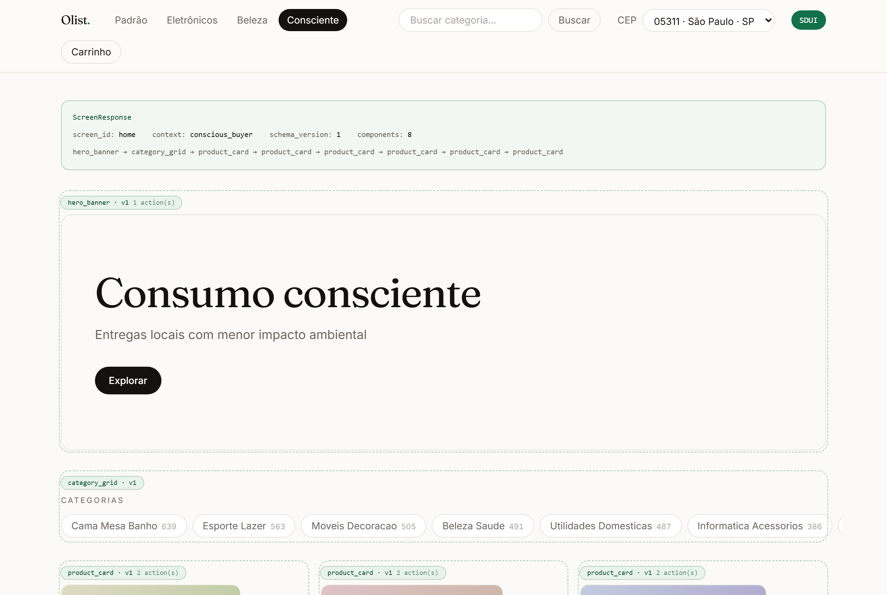
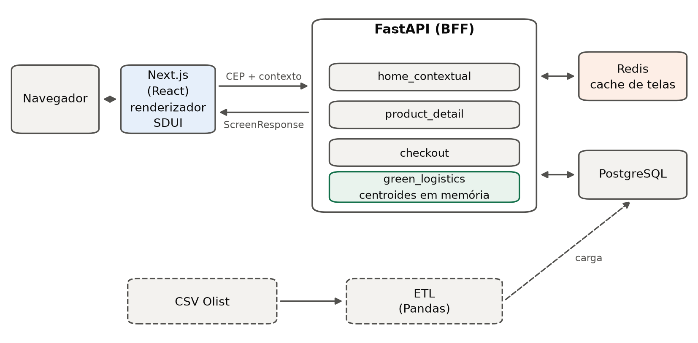
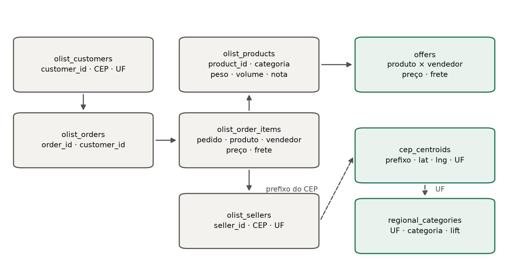
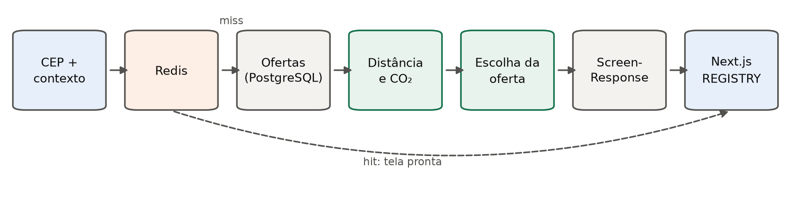

# Capítulo 4. Desenvolvimento

> **Versão 2 (13/10/2026).** Base: o Cap. 4 do `Report 6 - Resultados.docx` de
> 13/10, reescrito para legibilidade. Numeração de figuras e tabelas segue a do
> `.docx` (Figura 5 em diante; Tabela 2). Figuras prontas em `docs/tcc/figuras/`,
> geradas por `python -m scripts.figuras_tcc` (a Figura 5 é captura de tela).
> Trechos marcados **[Pendente]** dependem de decisão do grupo — ver o fim do arquivo.

## 4 DESENVOLVIMENTO

Este capítulo descreve como o marketplace contextual adaptativo foi construído
sobre o conjunto de dados público da Olist. A exposição segue três etapas:
primeiro, os requisitos e as delimitações do projeto; depois, a arquitetura, o
modelo de dados e o contrato entre servidor e interface; por fim, as decisões de
implementação, do tratamento dos dados ao ambiente de execução.

A ordem não reproduz a cronologia das sprints. O objetivo é mostrar como os
componentes se relacionam e como cada decisão atende aos objetivos do trabalho.
Os resultados das avaliações aparecem no Capítulo 5, que indica a versão do
sistema em que cada medição foi feita.

### 4.1 ESPECIFICAÇÃO

A especificação relacionou os objetivos do trabalho às funcionalidades da
jornada de compra, às exigências de desempenho e às limitações do conjunto de
dados. Mais do que uma lista de funções, ela definiu o comportamento esperado e
os critérios que permitiriam verificar se a solução atendia à proposta.

#### 4.1.1 Requisitos funcionais

O sistema deveria adaptar a apresentação dos produtos ao contexto do comprador,
considerar a localização dos vendedores e oferecer uma jornada de compra
simulada, sem se tornar uma plataforma de comércio eletrônico completa.

**Página inicial contextual.** A rota da página inicial recebe o prefixo do CEP
do comprador e devolve uma tela completa, representada pelo modelo
`ScreenResponse` (Figura 5). A tela reúne um banner principal, uma grade de
categorias e cartões de produtos. O comprador pode escolher um perfil, como
especialista em eletrônicos, interessado em beleza ou consumidor consciente.
Sem perfil escolhido, o sistema usa a UF do CEP para destacar a categoria que
aquele estado compra acima da média nacional.

Figura 5 - Página inicial no modo de inspeção SDUI

Fonte: Elaborada pelos autores (2026).

Na Figura 5, o quadro superior mostra a resposta enviada pelo servidor: o
identificador da tela, o contexto aplicado e a sequência de blocos. Cada bloco
da página aparece contornado e identificado pelo seu tipo.

**Busca e filtro.** Como a Olist não registra o nome dos produtos, a busca é
feita sobre a categoria. O termo digitado é normalizado (acentos, maiúsculas e
espaços), e o filtro usa o identificador da categoria. Assim, a interface não
oferece uma busca por nome que a base não poderia sustentar.

**Proximidade e selo verde.** Para cada produto da vitrine, calcula-se a
distância entre o CEP do comprador e o do vendedor pela fórmula de Haversine,
aplicada aos centroides dos prefixos de CEP. Ofertas a menos de 100 km em linha
reta recebem o selo de logística verde, acompanhado da distância e, quando o
peso do produto é conhecido, da emissão estimada. Sem dados suficientes, o selo
ou a informação correspondente é omitido, para não exibir uma recomendação
ambiental sem base numérica.

**Pegada de carbono.** A emissão é estimada por uma abordagem baseada em
atividade, compatível com a ISO 14083 e com os fatores do GLEC Framework. O
modelo evoluiu em relação ao fator único descrito no Capítulo 3: a distância em
linha reta é convertida em distância rodoviária pelo fator de circuidade 1,345
(LEE; CHAE, 2023), e o percurso é dividido em dois trechos. Os últimos
15 km são feitos por van (WORLD ECONOMIC FORUM, 2024) e o restante por caminhão
pesado. A massa considerada é a massa cobrável, isto é, o maior valor entre o
peso real e o peso cubado, calculado à razão de 6.000 cm³ por quilograma, o
divisor do peso cúbico que os Correios aplicam às encomendas (OLIST, 2022).
**[Pendente: incluir as referências novas e alinhar a versão do GLEC.]**

**Escolha da oferta.** Um mesmo produto pode ser vendido por mais de um
vendedor. Para que vitrine, detalhe e checkout mostrem sempre a mesma oferta,
adotou-se uma regra única: vence a oferta mais próxima. Ofertas cuja distância
fica a até 1% da menor (com piso de 1 km) são tratadas como equivalentes, e
entre elas vence a mais barata, desde que o desempate não troque uma oferta com
selo por uma sem selo.

**Detalhe do produto.** A rota de detalhe devolve uma nova `ScreenResponse`,
com os blocos de detalhe e de impacto logístico. A avaliação exibida é a média
das notas dos pedidos que contêm o produto, e a cidade e a UF vêm do cadastro
do vendedor. Descrições textuais e etiquetas de sustentabilidade não foram
incluídas, porque não existem na base.

**Checkout simulado.** A rota de simulação recebe os itens, as quantidades e,
opcionalmente, a modalidade de entrega. A resposta traz o resumo do carrinho, as
opções de entrega, as remessas por vendedor e o impacto estimado. Nada é pago,
reservado ou gravado.

O checkout também sugere trocas. Para a remessa de maior emissão, o sistema
procura **outro produto da mesma categoria** vendido mais perto do comprador e
informa quanto CO₂ a troca evitaria. Esse mecanismo é diferente da escolha de
oferta: a escolha de oferta mantém o produto e muda o vendedor, enquanto a
sugestão de troca muda o produto. Por isso, a troca é apresentada com preço e
distância próprios, e a decisão fica com o usuário.

**Modalidades de entrega.** A modalidade padrão usa o frete observado na base e
prazos medidos em entregas reais, agrupadas por faixa de distância. As
modalidades expressa e verde são cenários declarados sobre essa linha de base,
pois a Olist não informa transportadora, modal nem emissão por modalidade. A
própria tela avisa o usuário sobre essa distinção. **[Pendente: justificativa
dos fatores de preço, prazo e emissão de cada cenário.]**

**Ações dirigidas pelo servidor.** Navegação, chamadas à API e abertura de
modais são variantes do contrato de ações. O fluxo implementado usa navegação e
chamadas à API; a abertura de modal permanece prevista no contrato, mas nenhuma
tela a emite desde que o detalhe passou a ser uma tela enviada pelo servidor.

#### 4.1.2 Requisitos não funcionais, métricas e critérios de aceitação

Além das funcionalidades, o desenvolvimento considerou quatro requisitos não
funcionais: desempenho, integridade do contrato, tolerância a dados incompletos
e reprodutibilidade.

**Desempenho.** A meta experimental é um tempo de resposta inferior a 200 ms nos
cenários e percentis definidos na metodologia. A ferramenta de carga mede o
tempo até a resposta completa, um limite superior do tempo até o primeiro byte;
o critério adotado é, portanto, conservador. A meta não foi tratada como garantia
universal, pois depende da concorrência e do estado do cache. Todo acesso ao
banco na API é assíncrono (SQLAlchemy com asyncpg).

**Integridade do contrato.** O contrato é validado com modelos Pydantic v2 e
uniões discriminadas pelo campo `type`. No frontend, um espelho em TypeScript e
o registro de componentes React mantêm a correspondência entre os tipos
recebidos e os componentes renderizados. Testes automatizados verificam essa
correspondência, porque uma divergência poderia quebrar a tela mesmo com cada
lado funcionando isoladamente.

**Degradação segura.** Um componente desconhecido não pode interromper a
renderização, e um envelope incompleto deve ser normalizado quando possível. A
falta de coordenadas, peso, avaliação ou alternativa leva à omissão do campo
correspondente: o sistema nunca substitui uma ausência por um valor inventado.

**Reprodutibilidade.** A amostragem usa semente fixa, cada ensaio de carga
registra seus parâmetros e as análises de concentração regional, CO₂ evitado e
comparação com o OSRM são executadas por scripts próprios. As respostas do
serviço de roteamento foram guardadas em arquivo, o que permite recalcular as
métricas sem nova consulta à rede.

Os critérios de aceitação foram organizados em quatro grupos: cálculos de
distância, massa e emissão com entradas controladas; ordenação de ofertas,
remessas e alternativas; geração e interpretação do contrato SDUI; e jornada
completa sob carga. Os resultados estão no Capítulo 5.

#### 4.1.3 Delimitações do escopo

O sistema é um protótipo de demonstração e avaliação, não uma plataforma
comercial. A API usa uma amostra do conjunto da Olist, carregada em um
PostgreSQL local após os filtros de qualidade. As análises de concentração
logística e de CO₂ evitado, por outro lado, usam o conjunto completo. A separação
é necessária porque o volume que demonstra a aplicação não é o mesmo que permite
estudar o potencial logístico da base.

Ficaram fora do escopo a autenticação, os perfis de usuário, a gravação de
pedidos, o pagamento, o painel do vendedor e as consultas espaciais com PostGIS.
O roteamento entre versões de componentes também ficou para trabalhos futuros:
o campo `version` existe no contrato, mas todos os componentes estão na versão 1.

As distâncias são calculadas entre centroides de prefixos de CEP, e não entre
endereços. A comparação com o OSRM (Seção 5.1.3) mostrou que a estimativa
corrigida pela circuidade erra menos que a linha reta e preserva, na maioria
dos casos, a ordem dos vendedores. Ainda assim, o OSRM calcula a rota mais
rápida de carro, que não é necessariamente a da transportadora. As distâncias
exibidas são, portanto, estimativas comparativas.

Por fim, o modelo de emissão é linear na massa: agrupar itens de um mesmo
vendedor reduz o frete simulado, mas não a emissão. E a recomendação de um
vendedor mais próximo só existe quando o produto tem mais de uma oferta.

### 4.2 PROJETO

O projeto organizou as responsabilidades do sistema em três decisões: a divisão
do backend em fatias verticais, a estrutura relacional dos dados e o contrato
de comunicação entre servidor e interface. O objetivo foi manter próximas as
regras de personalização, os cálculos logísticos e a composição visual, sem
transferir ao cliente regras que deveriam ficar no servidor.

#### 4.2.1 Organização em Vertical Slices

O backend foi dividido em fatias verticais. Cada fatia reúne as regras de
negócio, a composição da tela e o acesso aos dados de uma funcionalidade. A
decisão se justifica porque cada resposta combina contexto, localização,
emissão e apresentação.

São quatro fatias e um módulo reservado:

- `home_contextual`: composição da página inicial, contexto regional, busca e filtros;
- `green_logistics`: centroides, distância, emissão, selo, escolha de oferta e modalidades de entrega;
- `product_detail`: tela de detalhe do produto;
- `checkout`: simulação do carrinho, divisão em remessas e sugestões de troca;
- `orchestrator`: reservado ao roteamento entre versões de componentes.

O backend atua como uma camada dedicada à interface (BFF). Ele consulta os
dados, aplica as regras e devolve a árvore de componentes pronta para o cliente.
Uma mudança na ordenação dos produtos, por exemplo, acontece só no servidor; o
cliente não precisa conhecer o cálculo de distância ou de emissão. A Figura 6
mostra a arquitetura implementada.

Figura 6 - Arquitetura implementada

Fonte: Elaborada pelos autores (2026).

O navegador conversa apenas com o Next.js, que repassa o CEP e o contexto ao
backend FastAPI e recebe de volta a `ScreenResponse`. O Redis guarda as telas
já montadas, e o PostgreSQL guarda os dados carregados por um processo de ETL
independente da API.

#### 4.2.2 Modelo de dados relacional (PostgreSQL)

O PostgreSQL guarda cinco tabelas derivadas diretamente da Olist (clientes,
pedidos, itens de pedido, produtos e vendedores) e três tabelas criadas no ETL
para as decisões do sistema (Figura 7). A categoria é uma coluna dos produtos, e
a nota média e o número de avaliações foram agregados na própria tabela de
produtos.

Figura 7 - Modelo de dados simplificado

Fonte: Elaborada pelos autores (2026).

As três tabelas derivadas aparecem em verde na Figura 7:

- `cep_centroids`: representa cada prefixo de CEP pela mediana das coordenadas da
  tabela de geolocalização e pela UF mais frequente. Por ser estática durante a
  execução, a tabela é carregada uma única vez, na primeira requisição que precisa
  dela, e mantida em memória. Um mecanismo de sincronização impede cargas
  simultâneas.
- `offers`: reúne as combinações de produto e vendedor, com preço e frete. Com
  ela, a vitrine deixa de depender da ordem em que os pedidos foram sorteados, e
  produtos com mais de uma oferta são comparados pela mesma regra no detalhe e no
  checkout.
- `regional_categories`: guarda, para cada UF que atende aos limiares mínimos de
  volume, a categoria de maior *lift*, isto é, a razão entre a participação da
  categoria nas compras da UF e a participação dela no Brasil. O cálculo usa o
  conjunto completo, mas só concorrem categorias presentes no catálogo carregado.

O ETL roda separado da API: usa Pandas para ler e transformar os arquivos CSV e
psycopg para gravar no PostgreSQL, enquanto a API usa acesso assíncrono. Assim,
o processamento em lote fica fora do caminho de atendimento das telas.

#### 4.2.3 Contrato SDUI (esquema e tipos de componentes)

O contrato permite que o servidor descreva cada bloco da interface sem que o
cliente conheça as regras que o produziram. Todo bloco segue o envelope
`{type, version, props, actions}`: `type` identifica o componente, `version`
permite evoluir o contrato, `props` traz os dados de apresentação e `actions`
descreve os comportamentos que o cliente deve executar.

A resposta completa, `ScreenResponse`, reúne a versão do esquema, o
identificador da tela, o contexto aplicado e a lista de componentes. A validação
usa uniões discriminadas do Pydantic, que distinguem as variantes pelo campo
`type`. A Tabela 2 lista os oito componentes implementados.

Tabela 2 – Componentes do contrato SDUI

| Componente (`type`) | Tela | Função |
|---|---|---|
| `hero_banner` | Página inicial | Destaque principal e motivo do contexto |
| `category_grid` | Página inicial | Categorias, cada uma com seu destino |
| `product_card` | Página inicial | Produto, preço e selo verde |
| `product_detail` | Detalhe | Dados do produto e inclusão no carrinho |
| `impact_banner` | Detalhe e checkout | Distância e CO₂ estimado |
| `checkout_summary` | Checkout | Itens, frete e total |
| `delivery_options` | Checkout | Modalidades com preço, prazo e emissão |
| `shipment_breakdown` | Checkout | Remessas por vendedor e sugestões de troca |

Fonte: Elaborada pelos autores a partir do contrato implementado (2026).

As ações do contrato são navegação, chamada à API e abertura de modal. A chamada
à API pode pedir uma nova tela (GET) ou enviar o carrinho para simulação (POST).
Em dois componentes, as ações ficam dentro dos itens: cada categoria tem seu
próprio destino, e cada sugestão de troca carrega a sua substituição.

No frontend, o registro de componentes associa cada `type` ao componente React
correspondente, e um espelho do contrato em TypeScript tipa as respostas. Um
tipo sem componente é ignorado, sem derrubar a tela. O modo de inspeção SDUI
(Figura 5) torna visível o envelope de cada bloco, o que facilita verificar o
desacoplamento.

### 4.3 IMPLEMENTAÇÃO

A implementação materializou as decisões de projeto: preparou os dados,
integrou as regras de distância, emissão e escolha de oferta às rotas do
backend e transformou as respostas em telas interpretadas pelo frontend.
Também configurou o cache e o ambiente de execução usados na demonstração e
nas avaliações.

#### 4.3.1 Tratamento e carga do conjunto de dados Olist

O ETL lê os arquivos CSV da Olist e sorteia 10.000 linhas de itens de pedido com
semente fixa. Em seguida, completa a amostra com todas as ofertas dos produtos
sorteados, chegando a 60.636 itens. Sem esse passo, um produto vendido por dois
vendedores poderia aparecer com apenas um. Com ele, os produtos com mais de um
vendedor passaram de 106 para 580. Como o sorteio é feito por linha de pedido,
produtos mais vendidos têm mais chance de entrar: a amostra é ponderada pela
popularidade, o que a aproxima do que um comprador encontra, mas impede
generalizar suas proporções para o catálogo inteiro.

Depois, o ETL calcula os centroides e a UF de cada prefixo de CEP, deriva as
ofertas, as categorias regionais e as avaliações agregadas, e descarta itens
sem peso ou sem geolocalização de cliente ou vendedor. Os arquivos originais não
são alterados.

Calcular centroides e contexto regional no ETL tira esse custo do caminho das
requisições: a API não precisa recalcular, a cada acesso, onde fica um CEP ou
qual categoria se destaca em uma UF.

#### 4.3.2 BFF em FastAPI: motor de cálculo logístico e cache (Redis)

As rotas do FastAPI seguem as fatias. Ao receber um pedido da página inicial ou
do checkout, o backend valida o CEP, busca produtos e ofertas, calcula as
distâncias e aplica a regra de escolha. Depois, o motor logístico estima a
emissão, e os compositores transformam o resultado em componentes SDUI
(Figura 8).

Figura 8 - Fluxo de composição de uma tela

Fonte: Elaborada pelos autores (2026).

Quando a tela já está no Redis, a resposta volta pronta e o processamento é
pulado (seta tracejada). Quando não está, a requisição percorre a consulta de
ofertas, o cálculo de distância e emissão, a escolha da oferta e a montagem da
`ScreenResponse`, que é então interpretada pelo registro de componentes no
cliente.

A distância usa os centroides em memória. A primeira requisição carrega a
tabela, e as seguintes consultam um dicionário, o que elimina idas repetidas ao
banco durante a ordenação de vários produtos.

O motor de emissão recebe a distância em linha reta e a massa cobrável. Ele
converte a distância em estimativa rodoviária, aplica o fator da van aos
últimos 15 km e o do caminhão pesado ao restante. O resultado é exibido em
quilogramas ou gramas, conforme a grandeza, para que emissões pequenas não
apareçam como zero.

O Redis guarda as respostas completas da página inicial por uma hora. Ele não
substitui as otimizações do backend: mesmo sem Redis, os centroides ficam em
memória e o PostgreSQL mantém seu cache de páginas. Por isso, nos ensaios, "cache
desabilitado" significa apenas a camada de respostas em Redis. As telas de
detalhe e de checkout não são guardadas em cache.

Nas modalidades de entrega, o frete padrão vem da amostra, e os prazos de
referência foram medidos em 95.921 entregas reais, por faixa de distância. Preço,
prazo e emissão das modalidades expressa e verde derivam dessa linha de base por
fatores declarados.

#### 4.3.3 Composição das telas e renderização no cliente

Os compositores do servidor ordenam os blocos de acordo com o contexto. Na
página inicial do consumidor consciente, os produtos aparecem do mais próximo
para o mais distante. No checkout, os itens são agrupados por vendedor, as
remessas vêm da maior para a menor emissão e as sugestões de troca consideram
distância e massa juntas.

O frontend usa Next.js com React. O cliente recebe a `ScreenResponse`, consulta o
registro de componentes e monta a tela sem repetir nenhuma regra de
recomendação. A abertura do detalhe e a simulação do checkout são executadas
pelo interpretador de ações.

Como não há gravação de pedidos, o carrinho fica no armazenamento local do
navegador e é validado a cada leitura. Isso basta para avaliar a jornada, cujo
foco é a composição dirigida pelo servidor e a simulação das consequências
logísticas.

O contrato é acompanhado de testes do renderizador, do interpretador de ações e
dos casos de degradação, além de testes de jornada no navegador com alterações
controladas na resposta SDUI. Os resultados estão no Capítulo 5.

#### 4.3.4 Ambiente de execução (Docker Compose)

O PostgreSQL e o Redis rodam em contêineres orquestrados pelo Docker Compose.
A API FastAPI roda no hospedeiro, e o frontend é iniciado separadamente para a
demonstração. Essa configuração foi mantida nas medições porque, no Windows, o
Docker roda sobre uma máquina virtual (WSL2), o que acrescentaria uma camada ao
caminho medido. Assim, a API e o gerador de carga se comunicaram pela interface
de *loopback*, com banco e cache em contêineres no mesmo hospedeiro.

A demonstração sobe em três passos: os serviços de dados, a carga do ETL e a
API. Se o banco for recarregado com a API no ar, é preciso reiniciá-la e limpar o
Redis, porque centroides e telas guardados em memória ficariam desatualizados.

Testes unitários, de contrato, de lint e de tipos rodam na integração contínua a
cada alteração. Os testes de carga e de navegador dependem dos arquivos brutos e
da pilha completa e, por isso, rodam no ambiente de avaliação.

O capítulo seguinte apresenta os resultados obtidos com esse sistema.

---

## Pendências para o grupo

| Item | O que falta | Card no Trello |
|---|---|---|
| Fonte do fator de cubagem (6.000 cm³/kg) | **Resolvido no texto:** citar OLIST (2022) no §4.1.1 do .docx (onde está o comentário do Word) e incluir nas Referências: OLIST. *Como calcular o frete dos produtos para envio pelos Correios?* São Paulo: Olist, 20 set. 2022. Disponível em: https://olist.com/blog/pt/gestao-empresarial/operacao-e-logistica/como-calcular-o-frete-dos-produtos-na-loja-virtual/ | Sprint 12 — fator de cubagem |
| Fatores das modalidades expressa e verde | Justificar ou citar os fatores (expressa: preço 1,6, CO₂ 2,5, prazo 0,5; verde: 0,85, 0,6, 1,5) | Sprint 12 — modalidades |
| Referências novas | Incluir nas Referências: LEE; CHAE (2023), *ISPRS International Journal of Geo-Information* 12(2), 57 (substitui Gonçalves et al., 2014, fora da janela de 5 anos); WORLD ECONOMIC FORUM (2024), *Transforming Urban Logistics*. O código usa os fatores do GLEC v2.0 (2019, rev. 2022); as Referências citam a v3.0 (2023) — alinhar | Sprint 11 — ajustes menores |
| Capítulo 3 | O Cap. 3 ainda descreve o fator único de 0,102 kg/(t·km) do GHG Protocol; o Cap. 4 agora diz que o modelo evoluiu. Ajustar o Cap. 3 ou manter a menção à evolução | Sprint 11 |
| Figura 4 (Cap. 3) | Mostra "React" e "E = d × m × f"; a Figura 6 mostra o sistema implementado | — |
