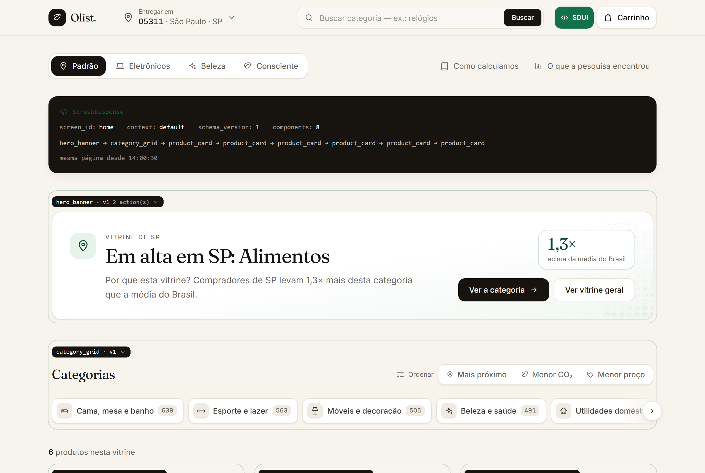
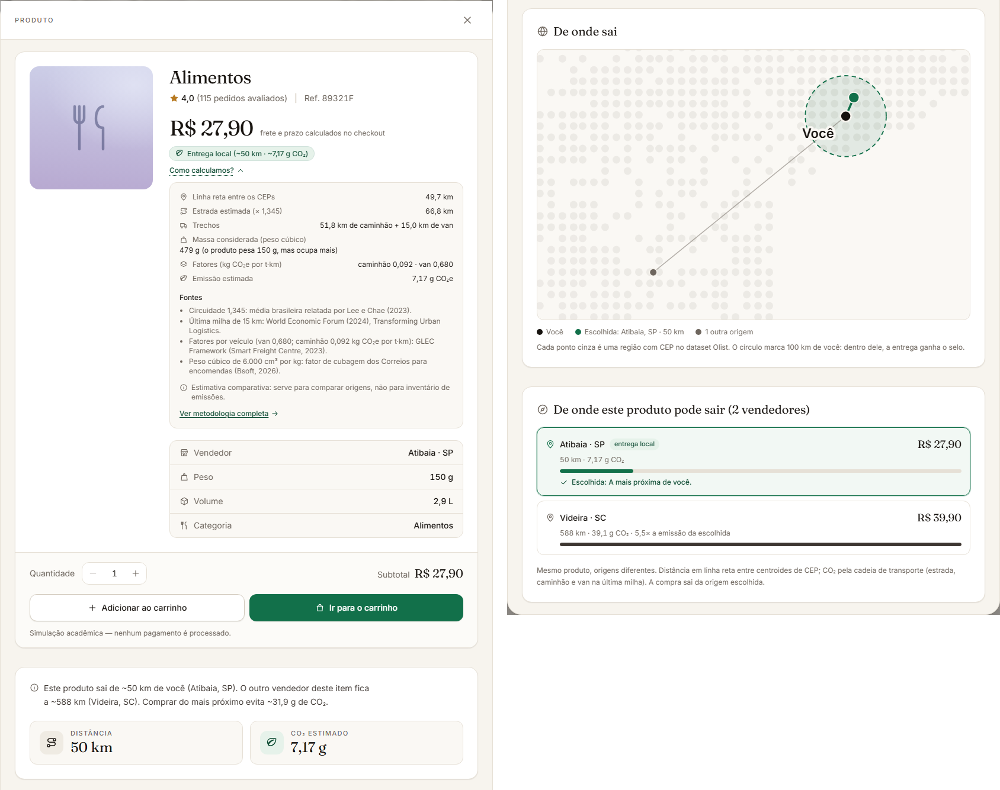
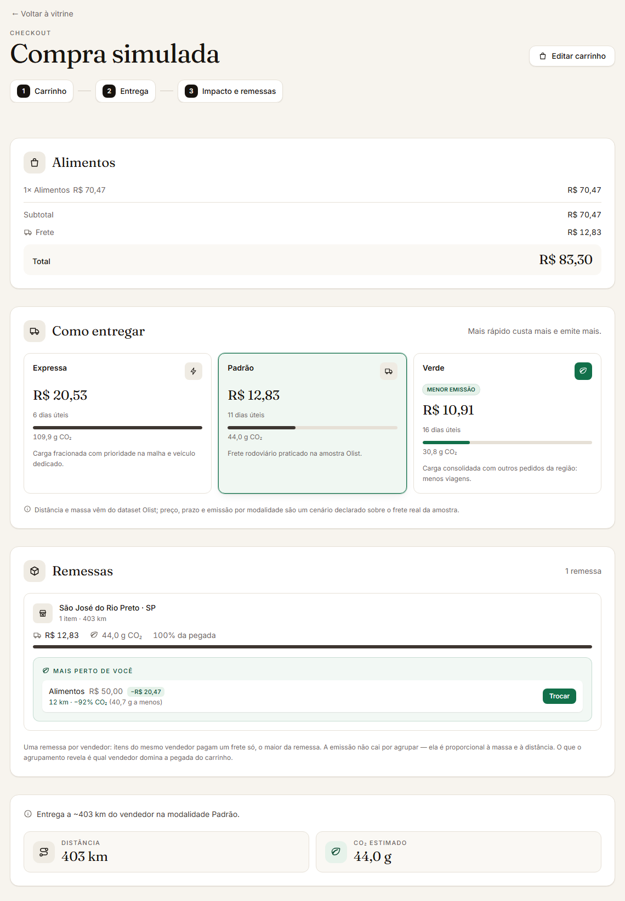
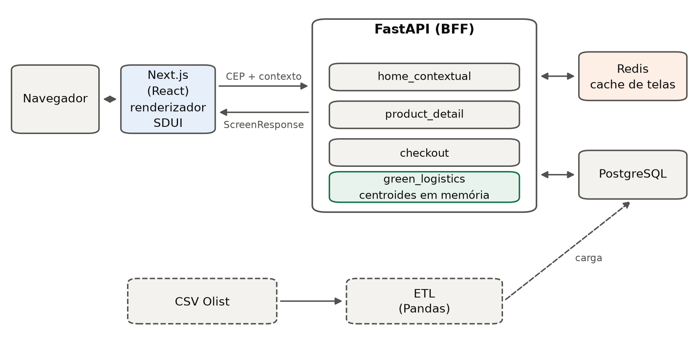
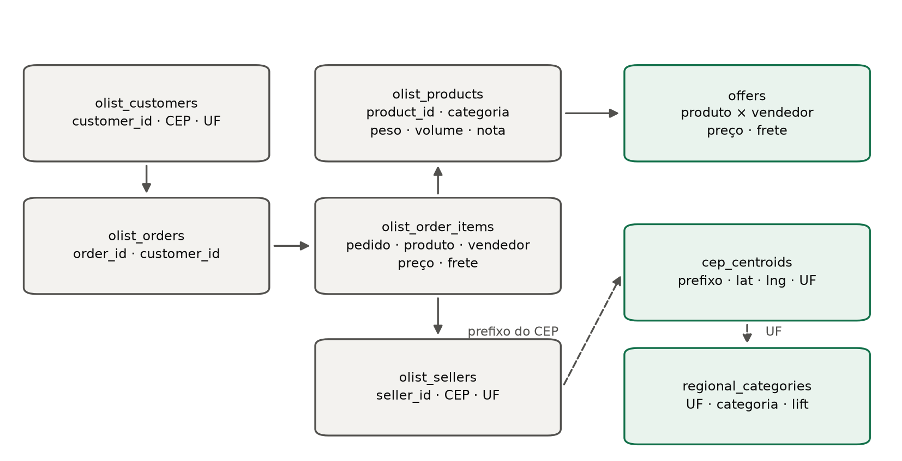
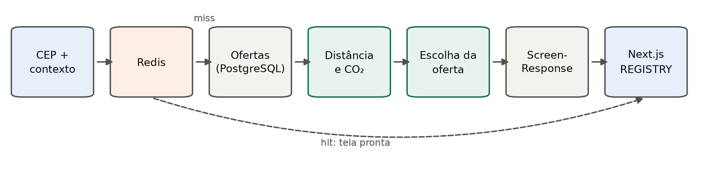

# Capítulo 4. Desenvolvimento

> **Versão 4 (02/11/2026).** Acrescenta os pontos novos de `analise-app-x-monografia.md`
> (marcados `<!-- A1 -->` etc.) e as Figuras 6 e 7; as demais figuras foram renumeradas.
> Fonte do `.docx` da versão final (`python docs/tcc/_gerar_docx.py`).
>
> **Versão 3 (02/11/2026).** Base: o Cap. 4 do `Report 6 - Resultados.pdf`
> (entrega de 14/10, versão mais atual do grupo), copiado do PDF, com os ajustes de
> `docs/tcc/ajustes-versao-final.md` **já aplicados**. Cada parágrafo alterado traz
> um comentário invisível `<!-- ID -->` com o achado correspondente (M4, M5, M9,
> m1, m2, m3, m6); o resto é o texto do PDF sem mudança. A v2 (13/10) está no
> histórico do git. Figuras em `docs/tcc/figuras/` (`python -m scripts.figuras_tcc`;
> a Figura 5 é captura de tela).

## 4 DESENVOLVIMENTO

Este capítulo apresenta o desenvolvimento do marketplace contextual adaptativo
proposto neste trabalho. A solução foi construída a partir do conjunto de dados
público da Olist e combina uma interface orientada pelo servidor com mecanismos
de personalização contextual e de apoio à logística verde. A exposição está
organizada em três momentos. Primeiro, são apresentados os requisitos e as
delimitações que orientaram o desenvolvimento. Em seguida, descrevem-se a
arquitetura, o modelo de dados e o contrato de comunicação entre o servidor e a
interface. Por fim, são detalhadas as principais decisões de implementação,
incluindo o tratamento dos dados, o cálculo logístico, a composição das telas e o
ambiente de execução.

O objetivo dessa organização é explicar como os componentes se relacionam e de
que maneira cada decisão contribui para os objetivos definidos no trabalho. O
artefato descrito neste capítulo é o mesmo que foi submetido aos testes
funcionais, à avaliação do contrato de interface e ao protocolo de carga
apresentados no Capítulo 5.

### 4.1 ESPECIFICAÇÃO

O desenvolvimento foi iniciado pela definição do que o sistema deveria realizar e
das condições que orientariam sua avaliação. Nesta etapa, foram relacionados os
objetivos do trabalho às funcionalidades da jornada de compra, às exigências de
desempenho e às limitações impostas pelo conjunto de dados da Olist. A
especificação, portanto, não foi tratada apenas como uma lista de funções, mas
como a delimitação do comportamento esperado e dos critérios que permitiriam
verificar se a solução atendia à proposta.

#### 4.1.1 Requisitos funcionais

Os requisitos funcionais foram definidos a partir dos objetivos específicos do
trabalho e das situações de uso previstas para o marketplace. O sistema deveria
ser capaz de adaptar a apresentação dos produtos ao contexto do comprador, levar
em consideração a localização dos vendedores e apresentar uma jornada de compra
simulada sem transformar o protótipo em uma plataforma de comércio eletrônico
completa.

O primeiro requisito refere-se à composição da tela inicial. A rota da página
inicial recebe o prefixo de CEP do comprador e devolve uma tela completa,
representada pelo modelo "ScreenResponse", como pode ser visto na Figura 5.

<!-- m3 -->
Figura 5 - Página inicial no modo de inspeção SDUI

Fonte: Elaborada pelos autores (2026).

A tela é composta por um banner principal, uma grade de categorias e cartões de
produtos. O contexto pode ser selecionado por perfis pré-definidos (como
especialista em eletrônicos, beleza ou consumidor consciente) ou derivado
automaticamente a partir do CEP informado, priorizando a categoria com maior
lift[^lift] regional na unidade federativa correspondente, desde que respeitados
os limiares mínimos de volume da base.

[^lift]: Métrica estatística que indica a sobre-representação de uma categoria em
uma região. Representa a razão entre a proporção de vendas da categoria na UF
analisada e a proporção de vendas dessa mesma categoria na média nacional.
Valores superiores a 1 indicam concentração de consumo local acima do padrão do
país.

Na Figura 5, pode-se observar que o quadro superior mostra a resposta enviada
pelo servidor: o identificador da tela, o contexto aplicado e a sequência de
blocos. Cada bloco da página aparece contornado e identificado pelo seu tipo.

Também foram previstos mecanismos de busca e filtragem. Como o conjunto de dados
da Olist não apresenta um nome textual para cada produto, a busca é realizada
sobre a categoria do produto. O termo informado pelo usuário passa por
normalização de acentuação, caixa e separação de palavras. O filtro por
categoria, por sua vez, utiliza o identificador da categoria presente no
conjunto de dados. Dessa maneira, a interface não apresenta uma funcionalidade de
busca por nome de produto que a base original não poderia sustentar.

<!-- R4 -->
A mesma ausência afeta a identificação de cada produto na vitrine: sem nome nem
descrição, todos os itens de uma categoria apareceriam com o mesmo título. Para
diferenciá-los sem inventar informação, o servidor envia, junto com a categoria,
uma referência curta derivada do identificador do produto, o peso, o volume e a
nota média dos pedidos avaliados, quando existe. O cliente desenha a capa do
cartão no tom e com o ícone da categoria, já que a base também não traz
fotografias. Os textos de destaque da página inicial seguem a mesma regra: cada
perfil descreve o que a vitrine faz e oferece uma ação real, como ordenar por
proximidade ou por menor emissão, e a vitrine geral informa quando a UF do
comprador não tem volume suficiente para um destaque regional.

O segundo requisito está relacionado à localização da oferta. Para cada produto
considerado na composição da vitrine, calcula-se a distância entre o CEP do
comprador e o CEP do vendedor por meio da fórmula de Haversine aplicada aos
centroides geográficos. Ofertas com distância inferior a 100 km podem receber o
selo de logística verde. O selo é acompanhado de uma indicação de distância e,
quando há massa ou volume disponível, de uma estimativa de emissão. Na ausência
de dados suficientes, o sistema omite o selo ou a informação correspondente,
evitando apresentar uma recomendação ambiental sem fundamento numérico. O
comprador também pode ordenar a vitrine por menor distância, menor emissão
estimada ou menor preço; a ordenação é feita pelo servidor, que devolve uma nova
árvore de componentes. <!-- A1 -->

<!-- M5 (evolução do CO₂ declarada aqui, P5) e m6 -->
O terceiro requisito corresponde ao cálculo da pegada de carbono. O modelo de
emissão evoluiu em relação ao fator único descrito no Capítulo 3, porque aplicar
o fator de caminhão também à última milha, feita por veículos menores,
subestimava a emissão das entregas locais. A emissão é estimada por uma
abordagem baseada em atividade, compatível com o enquadramento da ISO 14083 e com
os fatores do GLEC Framework. A distância geodésica é convertida em uma
distância rodoviária aproximada por meio do fator de circuidade 1,345, com base
em Lee e Chae (2023). O percurso é representado por dois trechos: uma etapa de
transferência realizada por caminhão pesado e uma etapa final de até 15 km
realizada por van, conforme a referência do World Economic Forum (2024). A massa
utilizada no cálculo é a massa cobrável, isto é, o maior valor entre o peso real
e o peso cubado. Para a cubagem, adotou-se a relação de 6.000 cm³ para cada
quilograma (BSOFT, 2026). Os fatores por veículo são os do GLEC Framework
(SMART FREIGHT CENTRE, 2023). Para que a estimativa não seja uma caixa-preta, o
selo oferece a opção "Como calculamos?", que abre a cadeia do cálculo da oferta
exibida: distância em linha reta, estrada estimada, trechos de caminhão e de van,
massa considerada, fatores e fontes (Figura 6). <!-- A2, M6 -->

<!-- m2 -->
O sistema também deveria manter uma regra única para a escolha da oferta. Um
mesmo produto pode aparecer associado a mais de um vendedor e, por isso, a
vitrine, a tela de detalhe e o checkout precisam apresentar uma escolha coerente.
A regra prioriza a menor distância. Consideram-se praticamente equivalentes as
ofertas cuja distância esteja dentro de uma tolerância de 1% da menor distância,
com piso de 1 km. Nesse conjunto, o preço é utilizado como critério de
desempate. O desempate nunca troca uma oferta com selo de logística verde por
outra sem selo. Assim, pequenas diferenças que não são significativas para a
aproximação geográfica não impedem a escolha de uma oferta mais barata.

Outro requisito foi a criação de uma tela de detalhe de produto orientada pelo
servidor. A rota de catálogo dos produtos devolve uma nova ScreenResponse,
composta principalmente pelos blocos de detalhe do produto e de impacto
logístico. As avaliações são obtidas da agregação de dados reais de avaliações da
Olist, enquanto a cidade e a UF do vendedor provêm da tabela de vendedores. Não
foram incluídas descrições textuais ou etiquetas de sustentabilidade, pois esses
dados não estão disponíveis no conjunto original.

<!-- A3, A4, B2 -->
Quando o produto é vendido por mais de um vendedor, a tela inclui um comparador
com todas as origens, cada uma com preço, distância, emissão estimada e quantas
vezes ela emite em relação à escolhida, e um mapa que mostra a origem escolhida,
as alternativas e o raio de 100 km do selo (Figura 6). O comparador concretiza o
que a metodologia previa na Seção 3.2: apresentar a redução relativa da opção de
menor emissão em comparação com outra alternativa.

Figura 6 - Tela de detalhe do produto: selo com o cálculo aberto, mapa de origem e comparador de ofertas

Fonte: Elaborada pelos autores (2026).

Para representar a etapa de compra, foi implementado um checkout simulado. A rota
de simulação de checkout recebe uma lista de itens, suas quantidades e,
opcionalmente, a modalidade de entrega. A resposta apresenta o resumo do
carrinho, as opções de entrega, a divisão das remessas por vendedor e o impacto
logístico estimado. O fluxo não realiza pagamento, não baixa estoque e não
persiste um pedido.

O checkout também sugere trocas. Para a remessa de maior emissão, o sistema
procura outro produto da mesma categoria vendido mais perto do comprador e
informa quanto CO₂ a troca evitaria. Esse mecanismo é diferente da escolha de
oferta: a escolha de oferta mantém o produto e muda o vendedor, enquanto a
sugestão de troca muda o produto. Por isso, a troca é apresentada com preço e
distância próprios, e a decisão fica com o usuário. As trocas aceitas somam-se
em um indicador da sessão, "Seu impacto", que mostra o CO₂ evitado pelas
escolhas do próprio usuário. A Figura 7 mostra o checkout com as três
modalidades de entrega, a remessa e uma sugestão de troca. <!-- A6 -->

Figura 7 - Checkout simulado: resumo, modalidades de entrega, remessas e sugestão de troca

Fonte: Elaborada pelos autores (2026).

<!-- M9 -->
**Modalidades de entrega.** A modalidade padrão usa o frete observado na base e
prazos medidos em entregas reais, agrupadas por faixa de distância. As
modalidades expressa e verde são cenários declarados sobre essa linha de base,
pois a Olist não informa transportadora, modal nem emissão por modalidade. A
própria tela avisa o usuário sobre essa distinção, e a página de metodologia do
sistema apresenta os fatores com a justificativa de cada um (Tabela 3).

Tabela 3 – Fatores das modalidades de entrega em relação à linha de base

| Modalidade | Preço | Prazo | CO₂ | Justificativa |
|---|---:|---:|---:|---|
| Padrão | × 1,0 | × 1,0 | × 1,0 | Linha de base medida: frete da amostra e prazo mediano de 95.921 entregas reais, por faixa de distância |
| Expressa | × 1,6 | × 0,5 | × 2,5 | Cenário sem fonte quantitativa: o veículo parte antes de completar a carga; o fator de CO₂ equivale a viajar com 40% da ocupação da entrega padrão |
| Verde | × 0,85 | × 1,5 | × 0,7 | Consolidar pedidos reduz em 30% o número de viagens (WORLD ECONOMIC FORUM, 2024). Esperar a consolidação alonga o prazo, e um desconto compensa o comprador (WORLD ECONOMIC FORUM, 2024) |

Fonte: Elaborada pelos autores (2026).

A literatura sustenta a direção dos fatores, não os valores: entregas mais
rápidas reduzem a consolidação e aumentam as viagens, e entregas consolidadas
fazem o contrário. Por isso, os números das modalidades expressa e verde são
apresentados como cenário de comparação e não entram nos resultados de emissão
do Capítulo 5, que usam apenas a linha de base.

Por fim, as ações da interface são descritas pelo servidor. Navegação, chamadas à
API e abertura de modais são representadas como variantes do contrato de ações.
Na versão implementada, o fluxo principal utiliza navegação e chamadas à API. A
ação de abertura de modal permanece prevista no contrato, embora o detalhe de
produto tenha passado a ser carregado como uma nova tela orientada ao servidor.

#### 4.1.2 Requisitos não funcionais, métricas e critérios de aceitação

Além das funcionalidades diretamente visíveis ao usuário, o desenvolvimento
considerou requisitos de desempenho, integridade do contrato, tolerância a dados
incompletos e reprodutibilidade.

<!-- m1 -->
O desempenho foi estabelecido como uma meta experimental de tempo até o primeiro
byte inferior a 200 ms nos cenários e percentis definidos na metodologia. Essa
meta não foi tratada como uma garantia universal, pois o comportamento depende do
nível de concorrência e da condição do cache. A ferramenta de carga mede o tempo
até a resposta completa, que é um limite superior do tempo até o primeiro byte; o
critério adotado é, portanto, conservador. A avaliação deveria comparar três
estados da camada de respostas em Redis, com cache desabilitado, frio e aquecido,
além de considerar o tempo de reflexão entre as requisições. O acesso ao banco de
dados da aplicação foi implementado de forma assíncrona, utilizando SQLAlchemy
com asyncpg.

A integridade do contrato foi tratada com modelos Pydantic v2 e uniões
discriminadas pelo campo type. No frontend, o contrato foi espelhado em
TypeScript, e o registro de componentes React mantém a correspondência entre os
tipos recebidos e os componentes renderizados. Essa correspondência é verificada
por testes, pois uma divergência entre servidor e cliente poderia produzir uma
tela incompleta mesmo quando cada parte estivesse funcionando isoladamente.

Também foi estabelecido que a interface deveria degradar de forma segura.
Componentes desconhecidos não podem interromper a renderização da tela, e um
envelope incompleto deve ser normalizado quando possível. Da mesma forma, a
ausência de coordenadas, massa, avaliação ou alternativa válida deve resultar na
omissão do campo correspondente. O sistema não deve substituir uma ausência de
informação por um valor inventado.

<!-- A2, A5, A8 -->
Dois requisitos acompanharam a interface. O primeiro é a transparência das
estimativas: toda emissão exibida pode ser decomposta pelo usuário, e uma página
de metodologia, também enviada pelo servidor, apresenta os parâmetros e as
fontes de cada fator. O segundo é a acessibilidade: a jornada completa, da
entrada do CEP ao checkout, deve poder ser percorrida apenas com o teclado.

A reprodutibilidade foi considerada desde o tratamento dos dados até os ensaios de
desempenho. A amostragem operacional utiliza semente fixa, os ensaios de carga
registram seus parâmetros e as análises de concentração regional, emissões
evitadas e comparação entre Haversine e OSRM são executadas por scripts
específicos. As respostas obtidas do serviço público de roteamento foram
preservadas em arquivo para que as métricas publicadas possam ser recalculadas
sem depender de uma nova consulta à rede.

Os critérios de aceitação foram organizados em quatro grupos. O primeiro reúne os
testes de distância, massa e emissão com entradas controladas. O segundo verifica
a ordenação das ofertas, das remessas e das alternativas. O terceiro confere a
geração e a interpretação do contrato SDUI. O quarto avalia a jornada completa e
o comportamento sob carga. Os resultados da aplicação desses critérios são
apresentados no Capítulo 5.

#### 4.1.3 Delimitações do escopo

O sistema foi desenvolvido como um protótipo de demonstração e avaliação, e não
como uma plataforma comercial pronta para produção. A API utiliza uma amostra
derivada do conjunto de dados da Olist, carregada em um PostgreSQL local após os
filtros de qualidade. As análises de concentração logística e de CO₂ evitado, por
sua vez, são executadas sobre o conjunto completo. Essa separação é necessária
porque o volume utilizado para demonstrar a aplicação não é o mesmo volume
utilizado para estudar o potencial logístico do conjunto de dados.

Ficaram fora do escopo a autenticação, os perfis de usuário, a persistência de
pedidos, o pagamento, o painel do vendedor e as consultas espaciais com PostGIS. O
módulo destinado a encaminhar diferentes versões de componentes também permanece
como uma extensão futura. O campo version já existe no contrato, mas todos os
componentes entregues utilizam a versão 1.

A distância utilizada pela aplicação continua sendo calculada entre centroides de
prefixos de CEP. A comparação realizada com o OSRM mostrou que a estimativa
corrigida pelo fator de circuidade apresenta erro menor do que a distância
Haversine crua e preserva, em grande parte, a ordenação das ofertas. Entretanto,
o OSRM representa a rota mais rápida de carro e não necessariamente a rota da
transportadora. Além disso, os pontos de origem e destino são centroides, não
endereços individuais. Por isso, as distâncias exibidas devem ser interpretadas
como estimativas comparativas.

Também foram delimitadas as premissas das modalidades de entrega, em que agrupar
itens de um mesmo vendedor reduz o frete simulado, mas não altera a pegada
calculada (a emissão), que é estritamente linear em relação à massa transportada.
A recomendação sustentável por proximidade restringe-se aos produtos que possuem
ofertas concorrentes ativas.

### 4.2 PROJETO

Com os requisitos definidos, a etapa de projeto organizou as responsabilidades
necessárias para transformar as regras de negócio em uma solução integrada. Foram
estabelecidas a divisão do backend em fatias verticais, a estrutura relacional
dos dados e a forma de comunicação entre o servidor e a interface. Essa etapa foi
decisiva para manter próximas as decisões de personalização, os cálculos de
logística e a composição visual, sem transferir ao cliente as regras que deveriam
permanecer centralizadas no servidor.

#### 4.2.1 Organização em Vertical Slices

Adotou-se a organização em fatias verticais para manter próximas as regras de
negócio, a composição das telas e o acesso aos dados de cada funcionalidade. Essa
decisão foi importante porque o sistema não se limita a consultar produtos: ele
precisa combinar contexto, localização, emissão e apresentação em uma mesma
resposta.

<!-- M4 -->
São cinco fatias:

a) home_contextual: composição da página inicial, contexto regional, busca e
filtros;

b) green_logistics: centroides, distância, emissão, selo, escolha de oferta,
modalidades de entrega e as telas de metodologia e de resultados da pesquisa;

c) product_detail: tela de detalhe do produto;

d) checkout: simulação do carrinho, divisão em remessas e sugestões de troca;

e) orchestrator: mutações do contrato no modo de apresentação, usadas para
demonstrar o desacoplamento ao vivo; o roteamento entre versões de componentes
permanece como extensão futura.

O backend atua como uma camada dedicada à interface (BFF). Ele consulta os dados,
aplica as regras e devolve a árvore de componentes pronta para o cliente. Uma
mudança na ordenação dos produtos, por exemplo, acontece só no servidor; o
cliente não precisa conhecer o cálculo de distância ou de emissão. A Figura 8
mostra a arquitetura implementada.

Figura 8 - Arquitetura implementada

Fonte: Elaborada pelos autores (2026).

O navegador conversa apenas com o Next.js, que repassa o CEP e o contexto ao
backend FastAPI e recebe de volta a ScreenResponse. O Redis guarda as telas já
montadas, e o PostgreSQL guarda os dados carregados por um processo de ETL
independente da API.

#### 4.2.2 Modelo de dados relacional (PostgreSQL)

O PostgreSQL foi utilizado para persistir as entidades necessárias à aplicação e
as tabelas derivadas durante o processo de preparação dos dados. As tabelas
originais representam clientes, pedidos, itens de pedido, produtos e vendedores.
As tabelas originadas do processo de preparação dos dados são cep_centroids,
offers e regional_categories. Sobre essa base foram criadas estruturas que tornam
possíveis as consultas e decisões específicas do sistema.

Figura 9 - Modelo de dados simplificado

Fonte: Elaborada pelos autores (2026).

As três tabelas derivadas aparecem em verde na Figura 9:

a) cep_centroids: representa cada prefixo de CEP pela mediana das coordenadas da
tabela de geolocalização e pela UF mais frequente. Por ser estática durante a
execução, a tabela é carregada uma única vez, na primeira requisição que precisa
dela, e mantida em memória. Um mecanismo de sincronização impede cargas
simultâneas.

b) offers: reúne as combinações de produto e vendedor, com preço e frete. Com
ela, a vitrine deixa de depender da ordem em que os pedidos foram sorteados, e
produtos com mais de uma oferta são comparados pela mesma regra no detalhe e no
checkout.

c) regional_categories: guarda, para cada UF que atende aos limiares mínimos de
volume, a categoria de maior lift, isto é, a razão entre a participação da
categoria nas compras da UF e a participação dela no Brasil. O cálculo usa o
conjunto completo, mas só concorrem categorias presentes no catálogo carregado.

O processo de carga é independente do tempo de execução da API. O script de ETL
utiliza Pandas para ler e transformar os arquivos CSV e psycopg para gravar o
resultado no PostgreSQL. A API, por outro lado, utiliza acesso assíncrono ao
banco. Essa separação evita que as dependências e as operações de processamento
em lote sejam incorporadas ao caminho de atendimento das telas.

#### 4.2.3 Contrato SDUI (esquema e tipos de componentes)

O contrato de comunicação foi definido para que cada bloco da interface pudesse
ser descrito pelo servidor sem que o cliente precisasse conhecer as regras que
levaram à sua composição. Cada bloco possui o envelope "{type, version, props,
actions}". O campo "type" identifica o componente, "version" permite evolução
futura do contrato, "props" contém os dados de apresentação e "actions" descreve
os comportamentos que o cliente deve executar.

<!-- M4 -->
A resposta completa é representada por "ScreenResponse", que reúne a versão do
esquema, o identificador da tela, o contexto aplicado e a lista de componentes. A
validação é feita com uniões discriminadas em Pydantic, o que permite distinguir
as variantes pelo campo type e manter explícitos os campos de cada bloco. A
Tabela 2 lista os doze componentes implementados.

Tabela 2 – Componentes do contrato SDUI

| Componente (type) | Tela | Função |
|---|---|---|
| hero_banner | Página inicial | Destaque principal e motivo do contexto |
| category_grid | Página inicial | Categorias, cada uma com seu destino |
| product_card | Página inicial | Produto, preço e selo verde |
| product_detail | Detalhe | Dados do produto e inclusão no carrinho |
| impact_banner | Detalhe e checkout | Distância e CO₂ estimado |
| offer_comparison | Detalhe | Ofertas do mesmo produto por origem, com preço, distância e CO₂ |
| origin_map | Detalhe | Mapa com a origem da oferta escolhida e das alternativas |
| checkout_summary | Checkout | Itens, frete e total |
| delivery_options | Checkout | Modalidades com preço, prazo e emissão |
| shipment_breakdown | Checkout | Remessas por vendedor e sugestões de troca |
| content_section | Metodologia e pesquisa | Texto explicativo enviado pelo servidor |
| data_table | Metodologia e pesquisa | Tabelas de parâmetros e resultados |

Fonte: Elaborada pelos autores a partir do contrato implementado (2026).

<!-- M4 -->
Os quatro componentes de comparação, mapa, texto e tabela foram incluídos depois
da primeira versão da jornada, sem alterar os anteriores. Os dois últimos compõem
as telas de metodologia e de resultados da pesquisa, que expõem ao usuário as
fontes e os fatores do cálculo e também são montadas pelo servidor.

<!-- B1 -->
O mapa e o detalhamento do cálculo, que o Capítulo 2 associa a micro-frontends,
foram implementados como blocos do próprio contrato. O registro de componentes
já isola cada bloco no cliente, e um micro-frontend acrescentaria um segundo
ciclo de publicação sem benefício para um protótipo com um único cliente.

As ações disponíveis no contrato são navegação, chamada à API e abertura de
modal. A ação de chamada à API pode solicitar uma nova tela por meio de uma
requisição GET ou enviar os dados do carrinho para a simulação de checkout por
meio de uma requisição POST. Em dois casos, as ações aparecem em níveis internos
do bloco. Cada categoria possui seu próprio destino, e cada alternativa de
remessa pode representar uma substituição diferente. Essa organização mantém
explícita a relação entre o elemento visual e o comportamento correspondente.

No frontend, o registro de componentes associa cada type recebido ao componente
React responsável por sua renderização. O contrato também possui um espelho em
TypeScript. O cliente foi projetado para ignorar de forma segura um tipo que
ainda não possua renderizador, sem transformar esse caso em uma falha da tela
inteira. O modo de inspeção SDUI foi incluído para tornar visível o envelope
recebido, seus tipos, suas ações e seus dados, o que facilita a verificação do
desacoplamento proposto.

### 4.3 IMPLEMENTAÇÃO

A implementação correspondeu à materialização das decisões apresentadas nas
etapas anteriores. Nela, os dados foram preparados para a execução da aplicação,
as regras de distância, emissão e escolha de ofertas foram integradas às rotas do
backend e as respostas foram transformadas em telas interpretadas pelo frontend.
Também foram configurados os mecanismos de cache e o ambiente de execução, de
modo que o mesmo artefato pudesse ser utilizado tanto na demonstração da jornada
quanto nos procedimentos de avaliação descritos no capítulo seguinte.

#### 4.3.1 Tratamento e carga do conjunto de dados Olist

O processo de preparação começa com a leitura dos arquivos CSV do conjunto de
dados público da Olist. A amostragem utilizada pela API é realizada com semente
fixa, de modo que a mesma configuração possa ser reconstruída. Depois da seleção
inicial dos itens, o processo completa as ofertas dos produtos selecionados,
chegando a 60.636 itens. Essa etapa é necessária porque a seleção linha a linha
de pedidos poderia apresentar um produto sem revelar que ele também possui
ofertas de outros vendedores.

Em seguida, são construídos os centroides dos prefixos de CEP e é associada uma
UF a cada prefixo quando essa informação está disponível. O ETL também deriva as
ofertas, as categorias regionais, as avaliações agregadas e os campos necessários
à composição do detalhe e do checkout. Registros sem peso utilizável ou sem
geolocalização válida de cliente ou vendedor são retirados antes da persistência.

A escolha por calcular os centroides durante o ETL reduz o custo das consultas em
tempo de execução. Da mesma forma, a derivação do contexto regional evita que a
API tenha de calcular novamente a participação das categorias a cada acesso à
página inicial. O resultado é um catálogo preparado para a demonstração, sem
alterar os arquivos brutos do Olist.

#### 4.3.2 BFF em FastAPI: motor de cálculo logístico e cache (Redis)

As rotas da aplicação são expostas pelo FastAPI e organizadas por fatias de
responsabilidade. Quando a página inicial ou um checkout é solicitado, o backend
valida o CEP, recupera os produtos e as ofertas disponíveis, calcula as
distâncias e aplica a regra de escolha. Em seguida, o motor logístico calcula a
emissão e os compositores transformam os dados em componentes SDUI, conforme
observado na Figura 10.

Figura 10 - Fluxo de composição de uma tela

Fonte: Elaborada pelos autores (2026).

Quando a tela já está no Redis, a resposta volta pronta e o processamento avança
diretamente sem passar pelas outras etapas, como pode ser visto na seta
tracejada. Quando a tela não está pronta, a requisição percorre a consulta de
ofertas, o cálculo de distância e emissão, a escolha da oferta e a montagem da
ScreenResponse, que é então interpretada pelo registro de componentes no cliente.

O cálculo de distância consome diretamente a estrutura de centroides indexada na
memória da aplicação. A primeira requisição carrega a tabela, e as seguintes
consultam um dicionário, o que elimina idas repetidas ao banco durante a
ordenação de vários produtos. O motor de emissão recebe a distância Haversine,
aplica a circuidade de 1,345 e calcula a pegada a partir da massa cobrável,
segregando o trajeto entre a última milha de até 15 km (fator de van) e o
percurso restante (fator de caminhão pesado). O resultado é exibido em
quilogramas ou gramas, conforme a grandeza, para que emissões pequenas não
apareçam como zero.

O Redis guarda as respostas completas da página inicial por uma hora. Ele não
substitui as otimizações do backend, porque mesmo sem Redis, os centroides ficam
em memória e o PostgreSQL mantém seu cache de páginas. Por isso, nos ensaios,
"cache desabilitado" significa apenas a camada de respostas em Redis. As telas de
detalhe e de checkout não são guardadas em cache.

Para compor as alternativas no checkout, o sistema associa ao frete base os prazos
de entrega estimados por faixas de distância, que são derivados a partir de
95.921 entregas reais da base, calculando multiplicadores objetivos para as
modalidades simuladas por faixa de distância. Preço, prazo e emissão das
modalidades expressa e verde derivam dessa linha de base por fatores declarados.

#### 4.3.3 Composição das telas e renderização no cliente

Os compositores do servidor organizam os blocos de cada tela de acordo com o
contexto e a funcionalidade solicitada. Na página inicial de consumidor
consciente, por exemplo, os cartões são ordenados pela proximidade. No checkout,
os itens são agrupados por vendedor, as remessas são ordenadas pela emissão
estimada e as alternativas são selecionadas considerando distância, massa e
potencial de redução de CO₂.

O frontend foi implementado com Next.js e utiliza React como biblioteca de
renderização. O cliente recebe a ScreenResponse, consulta o registro de
componentes e monta a tela sem repetir as regras de recomendação. A navegação para
o detalhe e a chamada de simulação do checkout são executadas pelo interpretador
de ações.

O carrinho é mantido no armazenamento local do navegador, pois não há
persistência de pedidos neste escopo. Na leitura, seus dados são validados antes
de serem utilizados. A ausência de um backend de pedidos não impede a avaliação
da jornada, pois o objetivo desta etapa é verificar a composição server-driven e
a simulação das consequências logísticas.

<!-- A9 -->
A mesma árvore de componentes é exibida em telas de celular, com o cabeçalho
reduzido (a busca recolhida em um botão) e os perfis, as categorias e a ordenação
dispostos em faixas que rolam na horizontal. A adaptação é feita no cliente, por
folhas de estilo, sem que o servidor precise conhecer o dispositivo.

O contrato foi acompanhado por testes do renderizador, do interpretador de ações e
dos casos de degradação. Também foram realizados testes de jornada com o
navegador, incluindo alterações controladas na resposta SDUI. A análise dessas
evidências pertence ao Capítulo 5, pois esta seção descreve apenas como o
mecanismo foi construído.

#### 4.3.4 Ambiente de execução (Docker Compose)

<!-- M5: o Cap. 3 passou a descrever o hospedeiro (P5) -->
O ambiente foi organizado com Docker Compose para os serviços PostgreSQL e Redis.
A API FastAPI é executada no hospedeiro e o frontend pode ser iniciado
separadamente para a demonstração visual. Essa configuração foi mantida nas
medições porque o ambiente utilizado era Windows com Docker sobre WSL2. Dessa
forma, a comunicação entre a API e o gerador de carga ocorreu por loopback,
enquanto o banco e o cache permaneceram em contêineres no mesmo hospedeiro. Essa
configuração mantém a comparação entre os estados do cache, mas acrescenta a
disputa por processador entre a API e o gerador de carga.

Para executar a demonstração, primeiro são iniciados os serviços de persistência.
Em seguida, o ETL carrega a amostra operacional e a API é iniciada. Quando o banco
é recarregado enquanto a API permanece ativa, o snapshot de centroides e as
respostas armazenadas no Redis precisam ser invalidados. Essa exigência decorre
do caráter estático dos dados mantidos em memória durante a execução.

O projeto também possui verificações automatizadas para o backend e para o
frontend. Os testes de carga e os testes de navegador dependem dos arquivos
brutos e da pilha em execução, por isso são executados no ambiente de avaliação,
enquanto os testes unitários, de contrato, de lint e de tipos podem ser executados
no fluxo de integração contínua.

Com essa configuração, o sistema reúne o conjunto de dados preparado, o backend
responsável pelas regras de negócio e o cliente responsável pela renderização. O
capítulo seguinte apresenta as evidências obtidas a partir desse artefato,
separando a qualidade dos dados, o comportamento funcional, as estimativas
logísticas, o desempenho e a flexibilidade do contrato.

---

## Ajustes aplicados sobre o texto do PDF

| ID | Onde | O que mudou |
|---|---|---|
| m3 | Figura 5 | Legenda: "Página inicial no modo de inspeção SDUI" |
| M5 | §4.1.1 (3º requisito), §4.3.4; §3.2–3.3 | Resposta da P5 (02/11): o Cap. 3 passou a descrever a API no hospedeiro, a carga, o cache e a validação OSRM (`pre-e-pos-textuais.md` → "CAPÍTULO 3 — AJUSTES"); a evolução do motor de CO₂ continua declarada aqui |
| m6 | §4.1.1 (3º requisito) | Cubagem citada por BSOFT (2026), por decisão do grupo (02/11); referência com "Disponível em:" |
| m2 | §4.1.1 (regra de oferta) | Desempate nunca troca oferta com selo por oferta sem selo |
| M9 | §4.1.1 (modalidades) | Tabela 3 nova com a Verde em × 0,7; as Tabelas 3–5 do Cap. 5 passam a 4–6 |
| m1 | §4.1.2 | Ressalva do Locust (resposta completa, limite superior do TTFB) |
| M4 | §4.2.1, §4.2.3 | Cinco fatias; orchestrator com as mutações; Tabela 2 com 12 componentes |
| M6 | §4.1.1 (3º requisito) | Fatores citados pela v3.0 (SMART FREIGHT CENTRE, 2023): a v2.0 (2019) fura a regra de referências de até 5 anos (decisão do grupo, 02/11) |
| R4 | §4.1.1 (busca) | Redesign de 02/11: identidade dos produtos (referência, peso, volume, nota) e heróis honestos com ações reais |
| A1–A9, B1, B2 | §§4.1.1, 4.1.2, 4.2.3, 4.3.3 | Pontos novos da análise da aplicação (v4); Figuras 6 e 7 novas; demais renumeradas (5, 8, 9, 10) |
