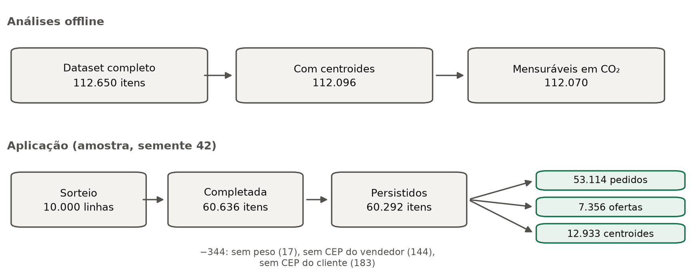
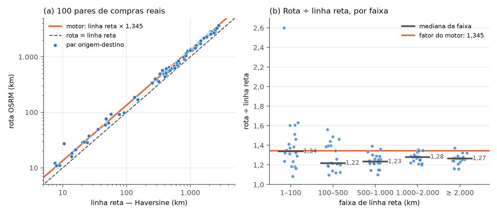
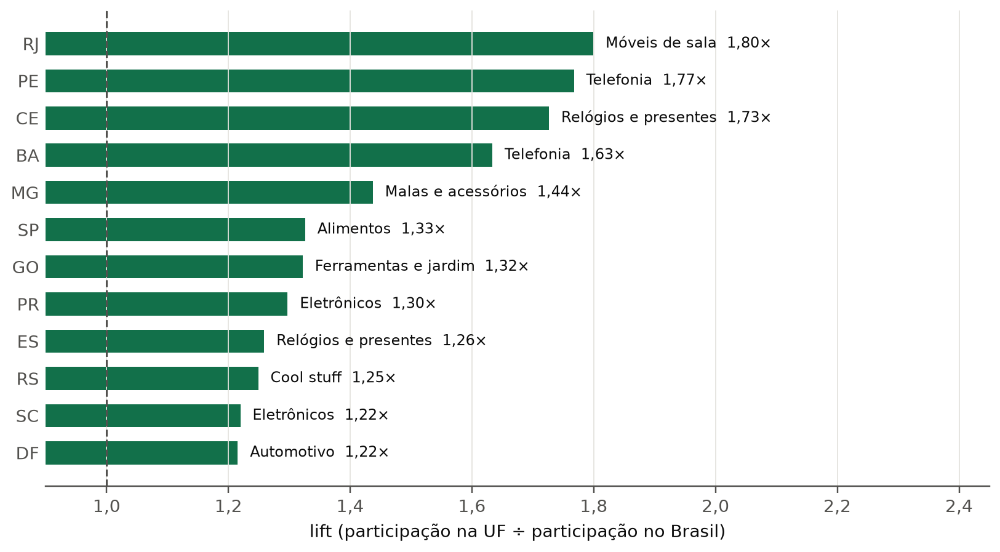
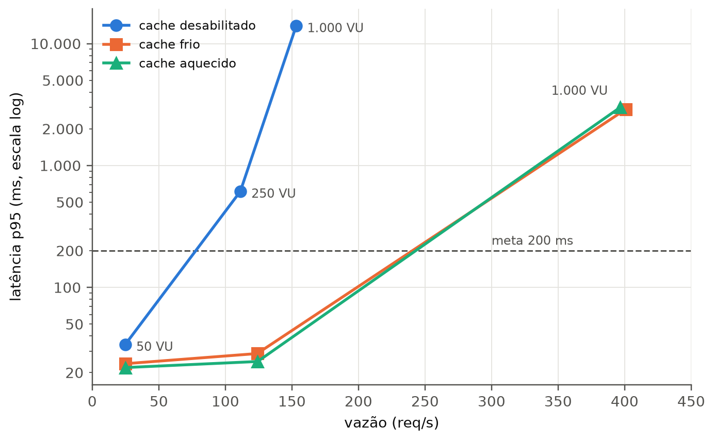
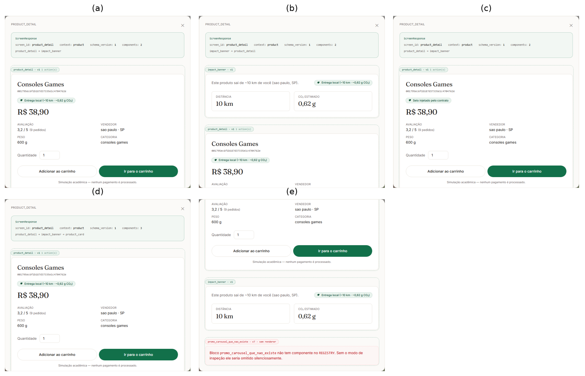

# Capítulo 5. Resultados

> **Versão 2 (13/10/2026).** Base: o Cap. 5 do `Report 6 - Resultados.docx` de
> 13/10, enxugado. Das 10 tabelas e 7 figuras pedidas, ficaram 3 tabelas e 5
> figuras, todas prontas em `docs/tcc/figuras/` (`python -m scripts.figuras_tcc`).
> O que saiu e por quê está no fim do arquivo. As correções do parecer
> (`docs/tcc/parecer-revisao-cap4-cap5.md`) já estão aplicadas no texto.

## 5 RESULTADOS

Este capítulo apresenta os resultados obtidos com o sistema descrito no
Capítulo 4. A análise responde a uma pergunta central: em que medida o sistema
combina personalização contextual, escolha de ofertas próximas, estimativa de
impacto ambiental e flexibilidade de apresentação, sem comprometer a jornada de
compra?

Os resultados estão divididos em duas dimensões. A quantitativa trata da base
de dados, do motor de cálculo, da precisão da distância, do potencial de
redução de emissões, da personalização regional e do desempenho sob carga. A
qualitativo-estrutural verifica se a interface aceita composições alteradas pelo
servidor e se resiste a componentes desconhecidos e a dados incompletos.

Ao longo do capítulo, três tipos de resultado são distinguidos: **observações**
diretas da base (como a distância de uma compra), **estimativas** do modelo
(como a emissão calculada a partir de distância e massa) e **cenários
contrafactuais** (como a emissão que teria ocorrido se o comprador escolhesse
outra oferta). Essa distinção evita apresentar uma estimativa como medição.

### 5.1 RESULTADOS QUANTITATIVOS

Os resultados quantitativos foram organizados de forma progressiva, partindo da
qualidade da base utilizada e chegando ao comportamento da aplicação sob carga.
Essa sequência permite compreender primeiro quais dados sustentam as análises,
depois verificar se as regras foram implementadas conforme o modelo definido e,
por fim, observar os efeitos da solução em escala experimental. Ao longo da
seção, os valores são acompanhados de sua base de cálculo e de suas limitações,
para que não sejam confundidas medições diretas, estimativas do modelo e
projeções contrafactuais.

#### 5.1.1 Qualidade e cobertura dos dados

Os resultados usam dois universos de dados (Figura 9). As análises de
logística verde partem do conjunto completo da Olist: 112.650 itens vendidos,
dos quais 112.096 têm coordenadas para comprador e vendedor e 112.070 reúnem
todos os campos do cálculo de emissão. A aplicação, por sua vez, usa uma amostra
de 60.636 itens, obtida pelo sorteio de 10.000 linhas e completada com todas as
ofertas dos produtos sorteados.

Figura 9 - Universos de dados das análises e da aplicação

Fonte: Elaborada pelos autores a partir dos resultados do ETL (2026).

Na amostra, 344 itens (0,57%) foram descartados por falta de peso ou de
geolocalização, e 60.292 foram gravados, com 53.114 pedidos, 7.356 ofertas e
12.933 centroides de CEP. A perda é pequena, mas o critério importa: o sistema
não atribui coordenadas padrão nem calcula emissão sem massa.

A complementação das ofertas foi decisiva. Sem ela, a amostra teria apenas 106
produtos com mais de um vendedor; com ela, passou a ter 580. Uma avaliação de
proximidade só tem sentido quando há alternativas: se a amostra escondesse as
outras ofertas, o sistema pareceria escolher o vendedor mais próximo apenas por
falta de opção. Como o sorteio é feito por linha de pedido, a amostra favorece
os produtos mais vendidos e não deve ser usada para estimar proporções do
catálogo inteiro.

Duas ressalvas acompanham todos os resultados. Os centroides representam um
prefixo de CEP, não um endereço, o que introduz incerteza nas distâncias. E a
base é histórica: a presença de um vendedor indica que a venda ocorreu entre
2016 e 2018, não que a oferta estaria disponível no momento da recomendação.

#### 5.1.2 Verificação funcional do motor de cálculo

Antes das análises agregadas, as regras do motor foram verificadas com entradas
controladas, como prevê a metodologia: distância de Haversine, conversão para
distância rodoviária, massa cobrável, divisão entre transferência e última
milha, fatores de emissão, escolha de oferta e ausência de recomendação quando
faltam dados. Na data desta versão, a suíte do backend somava 194 testes
aprovados e a do frontend, 35.

Um caso ilustra a cadeia de cálculo. Para 100 km em linha reta e 1 kg de massa,
o motor estima 134,5 km de estrada: 15 km de van, a 0,680 kg de CO₂e por
tonelada-quilômetro, e 119,5 km de caminhão pesado, a 0,092. O resultado é
0,021 kg de CO₂e. Os testes também confirmam que a emissão nunca diminui quando
a distância ou a massa aumentam, e que o peso cubado de uma remessa é calculado
sobre o conjunto dos itens. Somar o maior valor entre peso real e cubado item a
item cobraria duas vezes o espaço ocupado e superestimaria a massa.

Esses testes demonstram consistência interna, não precisão externa. Validar os
fatores de emissão exigiria dados de transportadoras, como veículo, rota,
ocupação e consumo, que a Olist não fornece.

#### 5.1.3 Acurácia da distância: Haversine e OSRM

A metodologia previu comparar a distância em linha reta com a distância de rota
calculada pelo OSRM. Foram usados 100 pares de compras reais, 20 em cada faixa
de distância, entre os mesmos centroides usados pela aplicação. A Tabela 3
resume a comparação.

Tabela 3 – Erro da distância estimada em relação à rota do OSRM

| Medida | Linha reta | Linha reta × 1,345 (motor) |
|---|---:|---:|
| Erro absoluto médio (MAE) | 248,9 km | 83,2 km |
| Erro percentual absoluto médio (MAPE) | 21,9% | 8,7% |
| Viés mediano | subestima em todos os pares | +6,2% |

Fonte: Elaborada pelos autores a partir da comparação com o OSRM (2026).

A linha reta subestima a estrada em cerca de 22%. Com o fator de circuidade, o
erro cai para 8,7%. A Figura 10 mostra por que o viés restante é positivo: até
100 km, a razão entre rota e linha reta (1,34) coincide com o fator adotado;
acima disso, as estradas são mais retas (1,22 a 1,28), e o motor superestima a
distância, e portanto a emissão, em 5% a 10%. O resultado é coerente com a
fonte do fator, estimado para distâncias menores (LEE; CHAE, 2023).

Figura 10 - Distância em linha reta e distância de rota

Fonte: Elaborada pelos autores a partir do OSRM (2026).

Para o marketplace, porém, o que importa é a ordem dos vendedores. Em 37
decisões reais, envolvendo 102 trajetos entre comprador e vendedor, o vendedor
mais próximo em linha reta também foi o mais próximo pela estrada em 32 (86,5%).
Nas cinco divergências, a escolha pela linha reta acrescentou no máximo 6,4 km
de estrada (2,1% da rota), e em três delas a própria regra de escolha já tratava
as ofertas como equivalentes. Com apenas 37 decisões, a incerteza desse
percentual é grande (intervalo de confiança de 95% entre 72% e 94%).

O fator de circuidade é, portanto, uma aproximação empiricamente apoiada: reduz
o erro e preserva a decisão de proximidade na maioria dos casos. As distâncias
exibidas continuam sendo estimativas comparativas, pois o OSRM calcula a rota
mais rápida de carro, não a rota da transportadora.

#### 5.1.4 Potencial estimado de redução de emissões

Esta seção usa o conjunto completo da Olist para responder a duas perguntas:
existe oferta próxima para os compradores, e quanto CO₂ seria evitado se o
vendedor mais próximo fosse escolhido? A Tabela 4 reúne os resultados.

Tabela 4 – Proximidade e potencial de redução de emissões

| Indicador | Resultado |
|---|---:|
| Itens com comprador e vendedor na mesma UF | 36,3% |
| Compras com vendedor a menos de 100 km | 18,7% |
| Compradores com algum vendedor a menos de 100 km | 94,7% |
| Itens cujo produto tinha mais de um vendedor | 14.367 (12,8%) |
| Desses, comprador já escolheu o mais próximo | 48,3% |
| Distância mediana desses itens: escolha real → mais próxima | 437 → 330 km |
| CO₂ evitado nesses itens | 254,2 kg CO₂e (9,8%) |
| CO₂ evitado sobre todas as compras mensuráveis | 0,9% |

Fonte: Elaborada pelos autores a partir das análises de concentração regional e CO₂ evitado (2026).

Os três primeiros indicadores mostram uma lacuna. Quase todos os compradores
(94,7%) tinham algum vendedor a menos de 100 km, mas só 18,7% das compras foram
locais. Proximidade estadual também não é proximidade real: uma compra na mesma
UF pode percorrer centenas de quilômetros.

A recomendação, no entanto, só pode agir quando o mesmo produto é vendido por
mais de um vendedor, o que ocorre em 12,8% dos itens. Nesses casos, metade dos
compradores já havia escolhido o mais próximo. Se todos seguissem a
recomendação, a distância mediana cairia de 437 para 330 km, e o modelo estima
254,2 kg de CO₂e evitados: 9,8% da emissão desses itens, ou 0,9% de todas as
compras mensuráveis. O primeiro número descreve o potencial onde a regra pode
agir; o segundo dimensiona o efeito sobre a base inteira.

O custo para o comprador foi pequeno. Nos 7.430 itens em que a recomendação
trocaria de vendedor, a oferta mais próxima era mais barata em 43,3% dos casos,
de mesmo preço em 6,3% e mais cara em 50,4%, com diferença mediana de R$ 0,01.
Como metade dos casos fica mais cara, a interface deve exibir distância, emissão
e preço juntos, em vez de esconder a decisão sob um selo.

Esses números são contrafactuais e devem ser lidos como potencial. O cálculo
supõe que a oferta mais próxima estaria disponível e que só a origem mudaria,
sem modelar estoque, consolidação de carga ou tipo de veículo. A análise compara
a escolha real com a oferta mais próxima, sem o desempate por preço usado pela
aplicação. E, como o fator de circuidade superestima as distâncias longas (Seção
5.1.3), os valores absolutos de emissão podem estar até cerca de 10% acima; a
ordem de grandeza e a conclusão não mudam. O mesmo vale para o fator de
cubagem: com a convenção rodoviária de 300 kg/m³ no lugar do divisor das
encomendas, a emissão absoluta sobe cerca de 60%, mas a parcela evitada fica
praticamente igual (9,6% contra 9,8%).

#### 5.1.5 Personalização contextual regional

Sem perfil escolhido, a página inicial destaca a categoria que a UF do
comprador compra acima da média nacional. A medida é o *lift*: a participação da
categoria nas compras da UF dividida pela participação dela no Brasil. Para
evitar ruído, só são personalizadas UFs com pelo menos 1.000 itens vendidos,
categorias com pelo menos 100 itens na UF e lift mínimo de 1,2.

Com esses limiares, 12 das 27 UFs receberam personalização (Figura 11), com
lifts entre 1,22 e 1,80. Os sinais mais fortes estão em móveis de sala no Rio de
Janeiro, telefonia em Pernambuco e na Bahia e relógios e presentes no Ceará.

Figura 11 - Categoria destacada por UF e intensidade do sinal regional

Fonte: Elaborada pelos autores a partir da tabela de categorias regionais (2026).

As 15 UFs restantes, incluindo todas as do Norte e boa parte do Nordeste, não
têm volume suficiente e recebem a vitrine geral. A personalização acontece no
nível da região, e não do indivíduo: sem login nem histórico de compras, o
sistema não conhece o comprador, apenas o seu CEP. Os limiares protegem contra
ruído, mas não constituem um teste de significância estatística. O custo de
desempenho foi nulo: a UF e a tabela regional ficam em memória, e a mediana do
tempo de resposta foi de 9,3 ms com a personalização e 9,5 ms sem ela.

#### 5.1.6 Desempenho sob carga e efeito do cache

O desempenho foi medido sobre a jornada completa, e não sobre uma chamada
isolada. A jornada inclui a página inicial em quatro variações de contexto, o
detalhe do produto e o checkout. O protocolo seguiu a metodologia: três níveis de
carga (50, 250 e 1.000 usuários virtuais), três estados do cache de respostas
em Redis e três repetições, totalizando 27 ensaios válidos. A Tabela 5 apresenta
as médias.

Tabela 5 – Desempenho da jornada por nível de carga e estado do cache

| Usuários virtuais | Cache | p50 | p95 | Vazão | Falhas |
|---:|---|---:|---:|---:|---:|
| 50 | desabilitado | 12,7 ms | 34 ms | 25 req/s | 0% |
| 50 | frio | 6,3 ms | 24 ms | 25 req/s | 0% |
| 50 | aquecido | 6,7 ms | 22 ms | 25 req/s | 0% |
| 250 | desabilitado | 173 ms | 613 ms | 111 req/s | 0% |
| 250 | frio | 5,7 ms | 29 ms | 124 req/s | 0% |
| 250 | aquecido | 5,7 ms | 25 ms | 124 req/s | 0,02% |
| 1.000 | desabilitado | 4.100 ms | 14.000 ms | 153 req/s | 0,21% |
| 1.000 | frio | 93 ms | 2.900 ms | 401 req/s | 0,03% |
| 1.000 | aquecido | 95 ms | 3.000 ms | 397 req/s | 0,07% |

Fonte: Elaborada pelos autores a partir dos ensaios de carga (2026). Médias de três repetições.

A Figura 12 mostra o mesmo resultado em forma de curva: o ponto em que a
latência dispara indica a capacidade do sistema.

Figura 12 - Latência p95 em função da vazão, por estado do cache

Fonte: Elaborada pelos autores a partir dos ensaios de carga (2026).

Com **50 usuários**, a meta de 200 ms foi cumprida nos três estados. Nesse
nível, o cache é uma otimização, não uma necessidade.

Com **250 usuários**, o cache decide. Sem ele, o processador da API chega a 91%
de uso, as requisições entram em fila e o p95 sobe para 613 ms. Com o cache, o
mesmo equipamento atende toda a demanda com p95 entre 25 e 29 ms e um terço do
processamento. A vazão parece pouco diferente (111 contra 124 req/s) porque os
usuários simulados esperam a resposta antes de pedir a próxima tela: sem cache,
eles passam mais tempo esperando e pedem menos.

Com **1.000 usuários**, o sistema satura nos três estados, mas não da mesma
forma. Sem cache, a mediana chega a 4,1 s. Com cache, a vazão é 2,6 vezes maior
(cerca de 400 req/s) e a mediana fica abaixo de 100 ms. O p95 agregado, porém,
continua em torno de 3 s, porque as telas de detalhe e de checkout não passam
pelo cache e formam a fila. A rota cacheada isolada, a página inicial do
consumidor consciente, ficou com p95 de 190 a 200 ms: no limite da meta, e não
abaixo dela.

Os estados frio e aquecido são praticamente iguais nas médias. A diferença
aparece apenas nos primeiros 1 a 3 minutos do ensaio frio, enquanto o Redis se
preenche, e desaparece em seguida.

Um ensaio complementar verificou se mais processos da API substituiriam o
cache. Sem cache e com 1.000 usuários, quatro processos elevaram a vazão de 170
para 284 req/s (1,7 vez), mas ocuparam cerca de três núcleos. O cache alcançou
cerca de 400 req/s com um único processo. Nesta máquina, portanto, mais
processos não substituem o cache.

Três limites acompanham esses números. API, banco, cache e gerador de carga
dividiram o mesmo computador, então os resultados comparam configurações entre
si, mas não representam um serviço distribuído em produção. Com três repetições,
a dispersão na carga máxima é alta (p95 com desvio de 1 a 1,5 s). E os ensaios
foram executados antes das últimas mudanças de regra do sistema (motor de
emissão em cadeia, contexto regional e regra única de oferta). Por isso, o
cenário de 250 usuários foi repetido na versão final, nos três estados do cache
e com três repetições. O custo de processamento por requisição ficou igual
(8,5 contra 8,3 ms sem cache), e com cache o p95 ficou em 19 ms, abaixo dos 25
a 29 ms originais. Sem cache, o p95 variou entre 600 e 1.200 ms entre as
repetições: com o processador acima de 90%, pequenas variações formam filas
longas. A conclusão sobre o cache se mantém. Por fim, catorze ensaios da
primeira execução foram descartados e refeitos: treze porque o computador
funcionou na bateria, com o processador em frequência reduzida, e um porque o
próprio gerador de carga saturou.

### 5.2 RESULTADOS QUALITATIVO-ESTRUTURAIS

Os resultados qualitativo-estruturais complementam as métricas anteriores ao
examinar a forma como a solução se comporta diante de alterações no contrato e
de situações que não podem ser reduzidas a um valor de latência ou emissão.
Nesta etapa, a avaliação concentrou-se na capacidade de o frontend interpretar
composições modificadas pelo servidor e de preservar a jornada quando recebe
blocos desconhecidos ou dados insuficientes. O foco, portanto, recai sobre o
desacoplamento e a robustez que sustentam a proposta de uma interface orientada
pelo servidor.

#### 5.2.1 Desacoplamento por mutação do contrato

Para verificar a flexibilidade da interface, um teste automatizado no navegador
interceptou a resposta real do servidor para a tela de detalhe e aplicou cinco
alterações ao JSON antes de entregá-lo ao cliente. As alterações foram
reordenar os blocos, injetar um selo, incluir um bloco conhecido que a tela não
tinha, incluir um tipo de bloco inexistente e remover o campo `actions` de um
bloco. O critério de sucesso foi a tela refletir a alteração sem novo *build* e
sem recarregar a página, o que foi comprovado por um marcador gravado no
navegador antes da primeira mutação e conferido ao final.

As cinco mutações foram aprovadas (Figura 13). A reordenação mostrou que a
ordem dos blocos vem do servidor, e não do código do cliente. O selo injetado
apareceu sem alteração na lógica do produto. O bloco novo foi renderizado, como
indica o cabeçalho da inspeção, que passou a contar três componentes. O tipo
inexistente não derrubou a tela: fora do modo de inspeção ele é ignorado, e
dentro dele aparece sinalizado. O bloco sem `actions` foi normalizado na entrada
e a tela continuou funcional.

Figura 13 - Mutações do contrato SDUI na tela de detalhe: (a) original; (b) blocos reordenados; (c) selo injetado; (d) bloco novo; (e) bloco desconhecido

Fonte: Elaborada pelos autores a partir do teste de mutação de contrato (2026).

O resultado confirma que o frontend atua como interpretador do contrato: a
árvore de blocos enviada pelo servidor, e não uma sequência fixa no cliente,
determina a tela. Há um limite, contudo. As mutações foram injetadas na resposta;
o teste prova que o cliente aceita árvores novas, não que o servidor as produza
sem alterar seu próprio código.

#### 5.2.2 Robustez do contrato, componentes desconhecidos e dados insuficientes

Uma base histórica nunca é completa: há produtos sem peso, sem avaliação ou com
um único vendedor. A estratégia adotada foi omitir o que não pode ser sustentado
pelos dados. Sem distância, o selo não aparece. Sem massa, a emissão não é
exibida. Acima de 100 km, o produto não recebe o selo. Sem uma alternativa
melhor, nenhuma troca é sugerida. Sem avaliações, a nota é omitida.

A ausência de selo, portanto, não afirma que a entrega é poluente: indica que
não há dados para classificá-la. Um selo atribuído a partir de um valor padrão
aumentaria artificialmente as entregas "verdes"; a omissão é menos chamativa,
mas mantém a relação entre afirmação e evidência.

A correspondência entre servidor e cliente também é verificada
automaticamente: um teste compara os tipos de blocos e ações declarados no
backend, no espelho em TypeScript e no registro de componentes. O teste compara
os tipos, mas não cada campo interno, e as situações avaliadas foram
controladas, não exaustivas. A convivência de versões diferentes do contrato em
produção não foi avaliada.

### 5.3 SÍNTESE DOS RESULTADOS

Os resultados respondem aos quatro objetivos específicos do trabalho.

**(a) Arquitetura SDUI.** As cinco mutações do contrato foram refletidas na tela
sem novo *build*, e componentes desconhecidos ou incompletos não interromperam a
jornada. O servidor determina a composição; o cliente a interpreta.

**(b) Motor de pegada de carbono.** O motor baseado em atividade passou nos
testes de unidade, conversão e monotonicidade. A distância corrigida pela
circuidade erra 8,7% em relação à rota do OSRM e escolhe o mesmo vendedor mais
próximo em 86,5% das decisões, com superestimação de 5% a 10% nas distâncias
longas.

**(c) Personalização integrada à logística.** A página inicial adapta-se à
região do comprador em 12 das 27 UFs, sem custo de desempenho. A recomendação
do vendedor mais próximo reduziria em 9,8% a emissão dos itens com alternativa,
equivalentes a 0,9% de todas as compras, com custo mediano de R$ 0,01 para o
comprador. O alcance é limitado pela oferta de alternativas, e não pela
existência de vendedores próximos.

**(d) Desempenho e flexibilidade.** A meta de 200 ms foi cumprida com 50
usuários em todos os estados e com 250 usuários quando o cache estava ativo. Com
1.000 usuários, o cache multiplicou a vazão por 2,6 e manteve a rota cacheada no
limite da meta, enquanto as rotas sem cache saturaram.

Essas conclusões valem dentro de limites declarados: dados históricos,
centroides de CEP, modelo estimativo de emissão, serviço público de rotas e
ambiente de carga em uma única máquina. O Capítulo 6 retoma esses limites e
separa o que foi demonstrado do que permanece como hipótese ou trabalho futuro.

---

## O que mudou em relação ao `.docx` (para o grupo)

**Ordem de prioridade usada para cortar.** O critério foi o vínculo com os
objetivos (a)–(d) e com o que o Cap. 3 prometeu medir:

| Prioridade | Resultado | Por quê | Forma final |
|---|---|---|---|
| 1 | Desempenho sob carga | Objetivo (d); maior promessa da §3.3 | Tabela 5 + Figura 12 |
| 2 | Redução de emissões | Objetivos (b) e (c); núcleo da logística verde | Tabela 4 |
| 3 | Mutação do contrato | Objetivos (a) e (d); promessa da §3.3 | Figura 13 |
| 4 | Haversine × OSRM | Promessa da §3.2 | Tabela 3 + Figura 10 |
| 5 | Personalização regional | Objetivo (c) e título do trabalho; faltava no capítulo | Figura 11 (seção nova 5.1.5) |
| 6 | Cobertura dos dados | §3.1; base para ler o resto | Figura 9 |
| 7 | Testes do motor | §3.3, mas é verificação interna | Texto, sem tabela |
| 8 | Dados insuficientes | Complementa a 5.2.1 | Texto, sem tabela |

**Cortado (informação redundante ou específica demais):**

- Tabela 5.1 (funil) e Tabela 5.6 (reconciliação): unificadas na Figura 9.
- Tabela 5.2 (casos de teste) e Figura 5.2 (diagrama de testes): viraram um exemplo no texto.
- Tabela 5.5 (comparação histórica × recomendação): unificada com a 5.4 na Tabela 4.
- Figura 5.4 (três distribuições): exigiria nova análise; o texto já dá o trade-off de preço.
- Tabela 5.8 (workers): virou um parágrafo.
- Tabela 5.9 (mutações): a Figura 13 mostra o mesmo.
- Tabela 5.10 e Figura 5.7 (dados insuficientes): viraram um parágrafo.

**Corrigido junto (achados do parecer):** fatores de emissão na ordem certa
(van 0,680; caminhão 0,092); cubagem explicada corretamente; Tabela 5 completa,
com as falhas registradas; meta de 200 ms descrita sem exagero; base do 1,7×
(170 req/s); definição de cache frio; motivo real dos descartes; viés acima de
100 km; denominadores e intervalo de confiança; amostra ponderada por
popularidade; versão dos ensaios declarada; personalização com resultado.
