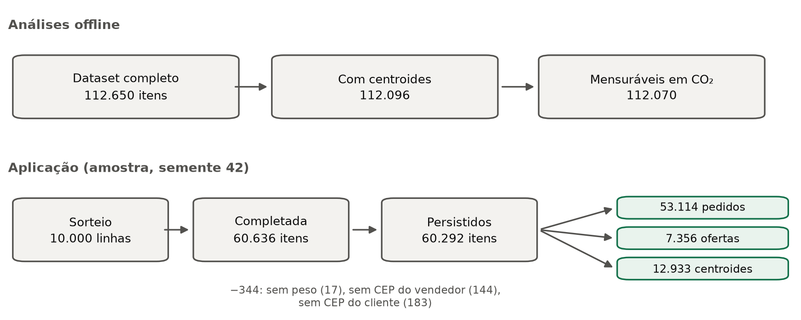
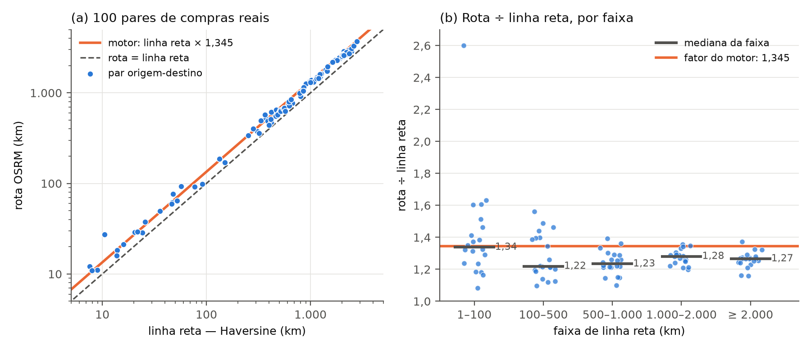
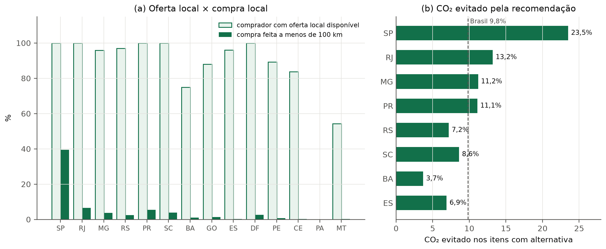
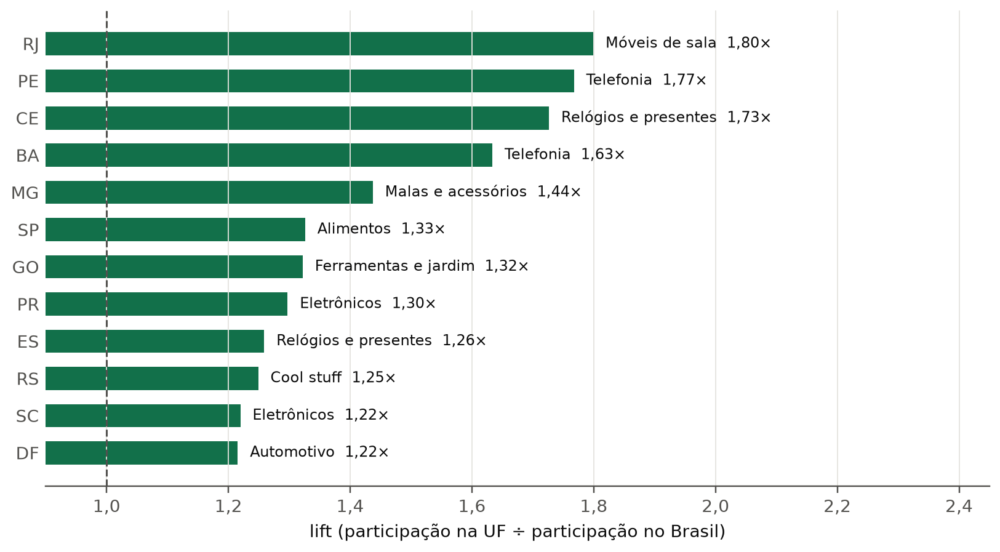
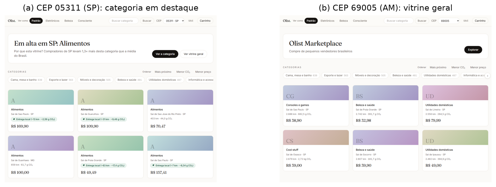
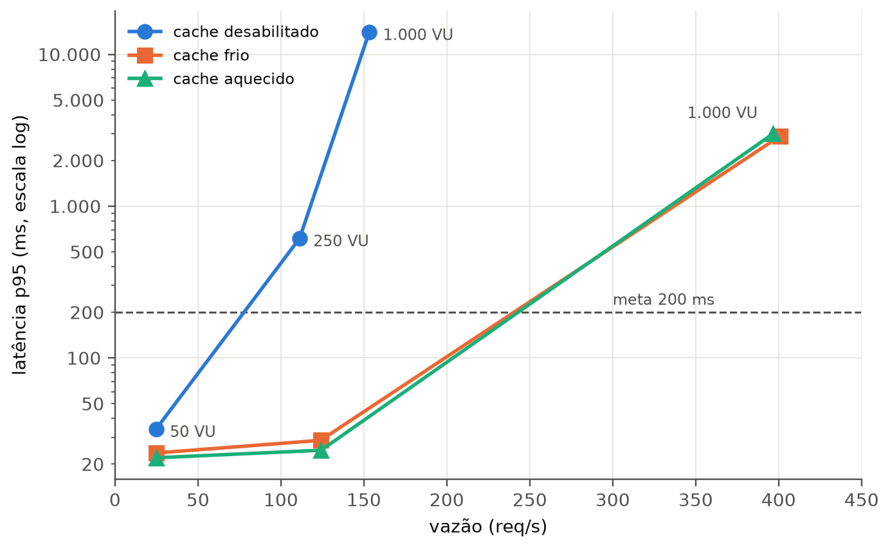
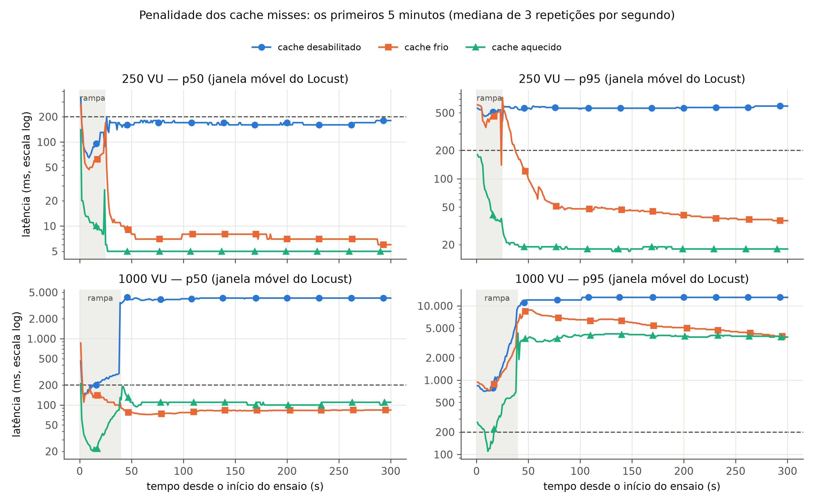
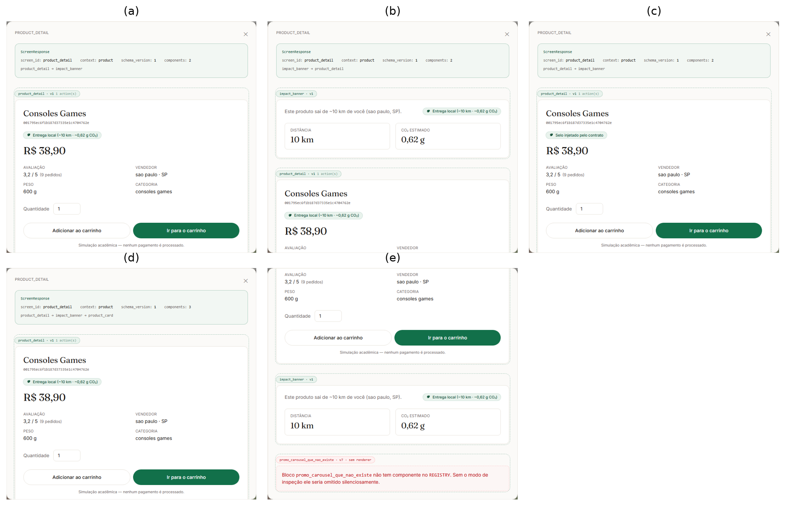
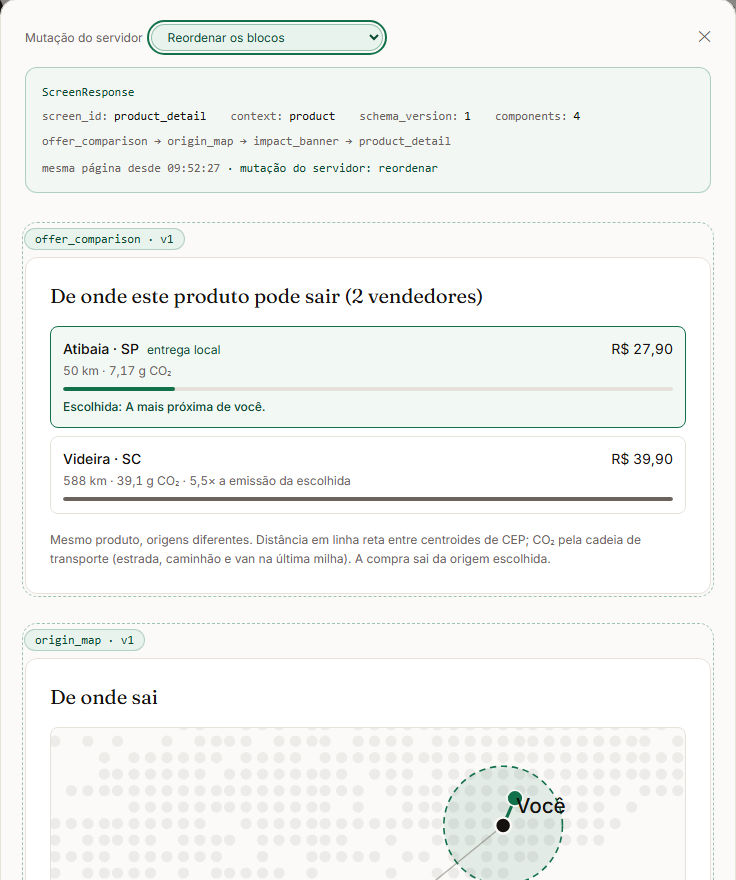

# Capítulo 5. Resultados

> **Versão 4 (02/11/2026).** Acrescenta os pontos novos de `analise-app-x-monografia.md`
> (marcados `<!-- C1 -->` etc.), as correções de `de-para-metricas.md` e as Figuras 13,
> 15, 17 e 19; as demais figuras foram renumeradas (11, 12, 14, 16, 18).
> Fonte do `.docx` da versão final (`python docs/tcc/_gerar_docx.py`).
>
> **Versão 3 (02/11/2026).** Base: o Cap. 5 do `Report 6 - Resultados.pdf`
> (entrega de 14/10, versão mais atual do grupo), copiado do PDF, com os ajustes de
> `docs/tcc/ajustes-versao-final.md` **já aplicados**. Cada parágrafo alterado traz
> um comentário invisível `<!-- ID -->` com o achado correspondente (M1, M2, M3,
> M8, m7); o resto é o texto do PDF sem mudança. Tabelas renumeradas (3 → 4,
> 4 → 5, 5 → 6) porque o Cap. 4 ganhou a Tabela 3 das modalidades. A v2 (13/10)
> está no histórico do git. Figuras em `docs/tcc/figuras/`
> (`python -m scripts.figuras_tcc`).

## 5 RESULTADOS

Este capítulo apresenta os resultados obtidos com a implementação descrita no
capítulo anterior. A análise foi organizada para responder a uma pergunta
central: em que medida o artefato construído consegue combinar personalização
contextual, escolha de ofertas próximas, estimativa de impacto ambiental e
flexibilidade de apresentação sem comprometer o funcionamento da jornada de
compra?

Os resultados foram divididos em duas dimensões. A primeira é quantitativa e
reúne evidências sobre a cobertura dos dados, o comportamento do motor de
cálculo, a aproximação da distância rodoviária, o potencial estimado de redução
de emissões, a personalização regional e o desempenho da aplicação sob carga. A
segunda é qualitativa e examina aquilo que não pode ser resumido por uma única
métrica, como a capacidade de alterar a árvore de componentes, a tolerância a
blocos desconhecidos e a correspondência entre o contrato produzido pelo backend
e o contrato interpretado pelo frontend.

Essa separação não significa que as duas dimensões sejam independentes. Os
resultados quantitativos dependem do tratamento dos dados e das regras
implementadas no backend, enquanto os resultados estruturais indicam se essas
regras podem ser apresentadas e alteradas sem reescrever a interface. Por isso,
cada seção apresenta primeiro o procedimento de avaliação, depois os valores
observados e, por fim, uma interpretação relacionada aos objetivos do trabalho.

É importante distinguir três tipos de resultado apresentados ao longo do
capítulo. Alguns valores são observações diretas do conjunto de dados, como a
quantidade de pedidos e a distância dos casos avaliados. Outros são resultados de
um modelo, como a emissão de CO₂ calculada a partir de distância e massa. Há
ainda resultados contrafactuais, como a emissão que seria obtida caso o comprador
tivesse escolhido uma oferta alternativa. Essa distinção impede que uma
estimativa seja apresentada como medição operacional.

### 5.1 RESULTADOS QUANTITATIVOS

Os resultados quantitativos foram organizados de forma progressiva, partindo da
qualidade da base utilizada e chegando ao comportamento da aplicação sob carga.
Essa sequência permite compreender primeiro quais dados sustentam as análises,
depois verificar se as regras foram implementadas conforme o modelo definido e,
por fim, observar os efeitos da solução em escala experimental. Ao longo da
seção, os valores são acompanhados de sua base de cálculo e de suas limitações,
para que não sejam confundidas medições diretas, estimativas do modelo e
projeções contrafactuais.

#### 5.1.1 Qualidade e cobertura dos dados

Os resultados usam dois universos de dados (Figura 11). As análises de logística
verde partem do conjunto completo da Olist: 112.650 itens vendidos, dos quais
112.096 têm coordenadas para comprador e vendedor e 112.070 reúnem todos os
campos do cálculo de emissão. A aplicação, por sua vez, usa uma amostra de 60.636
itens, obtida pelo sorteio de 10.000 linhas e completada com todas as ofertas dos
produtos sorteados.

Figura 11 - Universos de dados das análises e da aplicação

Fonte: Elaborada pelos autores a partir dos resultados do ETL (2026).

Na amostra, 344 itens (0,57%) foram descartados por falta de peso ou de
geolocalização, e 60.292 foram gravados, com 53.114 pedidos, 7.356 ofertas e
12.933 centroides de CEP. A perda é pequena, mas o critério importa: o sistema
não atribui coordenadas padrão nem calcula emissão sem massa.

A complementação das ofertas foi decisiva. Sem ela, a amostra teria apenas 106
produtos com mais de um vendedor; com ela, passou a ter 580, antes dos descartes. Uma avaliação de
proximidade só tem sentido quando há alternativas: se a amostra escondesse as
outras ofertas, o sistema pareceria escolher o vendedor mais próximo apenas por
falta de opção. Como o sorteio é feito por linha de pedido, a amostra favorece os
produtos mais vendidos e não deve ser usada para estimar proporções do catálogo
inteiro.

Duas ressalvas acompanham todos os resultados. Os centroides representam um
prefixo de CEP, não um endereço, o que introduz incerteza nas distâncias. E a
base é histórica: a presença de um vendedor indica que a venda ocorreu entre 2016
e 2018, não que a oferta estaria disponível no momento da recomendação.

#### 5.1.2 Verificação funcional do motor de cálculo

<!-- M3 -->
Antes das análises agregadas, as regras do motor foram verificadas com entradas
controladas, como prevê a metodologia: distância de Haversine, conversão para
distância rodoviária, massa cobrável, divisão entre transferência e última milha,
fatores de emissão, escolha de oferta e ausência de recomendação quando faltam
dados. Na versão final, a suíte do backend somava 229 testes aprovados e a do
frontend, 42, além de 7 testes de jornada no navegador.

Um caso ilustra a cadeia de cálculo. Para 100 km em linha reta e 1 kg de massa, o
motor estima 134,5 km de estrada: 15 km de van, a 0,680 kg de CO₂e por
tonelada-quilômetro, e 119,5 km de caminhão pesado, a 0,092. O resultado é 0,021
kg de CO₂e. Os testes também confirmam que a emissão nunca diminui quando a
distância ou a massa aumentam, e que o peso cubado de uma remessa é calculado
sobre o conjunto dos itens. Somar o maior valor entre peso real e cubado item a
item cobraria duas vezes o espaço ocupado e superestimaria a massa.

Esses testes demonstram consistência interna, não precisão externa. Validar os
fatores de emissão exigiria dados de transportadoras, como veículo, rota,
ocupação e consumo, que a Olist não fornece.

#### 5.1.3 Acurácia da distância: Haversine e OSRM

A metodologia previu comparar a distância em linha reta com a distância de rota
calculada pelo OSRM. Foram usados 100 pares de compras reais, 20 em cada faixa de
distância, entre os mesmos centroides usados pela aplicação. A Tabela 4 resume a
comparação.

Tabela 4 – Erro da distância estimada em relação à rota do OSRM

| Medida | Haversine crua | Haversine corrigida |
|---|---:|---:|
| MAE em relação ao OSRM | 248,9 km | 83,2 km |
| MAPE em relação ao OSRM | 21,9% | 8,7% |
| Viés mediano | Subestima em todos os pares | +6,2% após correção |
| Correlação de Spearman | 0,997 | 0,997 |

Fonte: Elaborada pelos autores (2026).

A linha reta subestima a estrada em cerca de 22%. Com o fator de circuidade, o
erro cai para 8,7%. A Figura 12 mostra por que o viés restante é positivo: até
100 km, a razão entre rota e linha reta (1,34) coincide com o fator adotado;
acima disso, as estradas são mais retas (1,22 a 1,28), e o motor superestima a
distância, e, portanto, a emissão, em 5% a 10%. O resultado é coerente com a
fonte do fator, estimado para distâncias menores (LEE; CHAE, 2023).

Figura 12 - Distância em linha reta e distância de rota

Fonte: Elaborada pelos autores a partir do OSRM (2026).

Para o marketplace, porém, o que importa é a ordem dos vendedores. Em 37 decisões
reais, envolvendo 102 trajetos entre comprador e vendedor, o vendedor mais
próximo em linha reta também foi o mais próximo pela estrada em 32 (86,5%). Nas
cinco divergências, a escolha pela linha reta acrescentou no máximo 6,4 km de
estrada (2,1% da rota), e em três delas a própria regra de escolha já tratava as
ofertas como equivalentes. Com apenas 37 decisões, a incerteza desse percentual é
grande (intervalo de confiança de 95% entre 72% e 94%).

O fator de circuidade é, portanto, uma aproximação empiricamente apoiada: reduz o
erro e preserva a decisão de proximidade na maioria dos casos. As distâncias
exibidas continuam sendo estimativas comparativas, pois o OSRM calcula a rota
mais rápida de carro, não a rota da transportadora.

#### 5.1.4 Potencial estimado de redução de emissões

Esta seção usa o conjunto completo da Olist para responder a duas perguntas:
existe oferta próxima para os compradores, e quanto CO₂ seria evitado se o
vendedor mais próximo fosse escolhido? A Tabela 5 reúne os resultados.

Tabela 5 – Proximidade e potencial de redução de emissões

| Indicador | Resultado |
|---|---:|
| Itens com comprador e vendedor na mesma UF | 36,3% |
| Compras com vendedor a menos de 100 km | 18,7% |
| Compradores com algum vendedor a menos de 100 km | 94,7% |
| Itens cujo produto tinha mais de um vendedor | 14.367 (12,8%) |
| Desses, comprador já escolheu o mais próximo | 48,3% |
| Distância mediana desses itens: escolha real → mais próxima | 437 → 330 km |
| CO₂ evitado nesses itens | 254,2 kg CO₂e (9,8%) |
| CO₂ evitado sobre todas as compras mensuráveis | 0,9% |

Fonte: Elaborada pelos autores a partir das análises de concentração regional e
CO₂ evitado (2026).

Os três primeiros indicadores mostram uma lacuna. Quase todos os compradores
(94,7%) tinham algum vendedor a menos de 100 km, mas só 18,7% das compras foram
locais. Proximidade estadual também não é proximidade real: uma compra na mesma
UF pode percorrer centenas de quilômetros.

<!-- C1, C3 -->
A média nacional esconde diferenças regionais (Figura 13a). Em SP, RJ, PR, SC e
DF, todos os compradores tinham oferta local; na BA, 74,9%; no MT, 54,3%; e no
PA, nenhum. A distância mediana das compras vai de 163 km em SP a 2.391 km no PA.
A oferta local, quando existe, também não garante a compra local: o RJ tinha
vendedor a menos de 100 km para todos os compradores e só 6,6% de compras
locais, contra 39,5% em SP. A lacuna, portanto, é de escolha, e não apenas de
oferta, o que justifica uma interface que torne a proximidade visível.

Figura 13 - Oferta local, compra local e CO₂ evitado por UF: (a) compradores com oferta local disponível e compras feitas a menos de 100 km; (b) CO₂ evitado nos itens com alternativa

Fonte: Elaborada pelos autores a partir das análises de concentração regional e CO₂ evitado (2026).

A recomendação, no entanto, só pode agir quando o mesmo produto é vendido por
mais de um vendedor, o que ocorre em 12,8% dos itens. Nesses casos, metade dos
compradores já havia escolhido o mais próximo. Se todos seguissem a
recomendação, a distância mediana cairia de 437 para 330 km, e o modelo estima
254,2 kg de CO₂e evitados: 9,8% da emissão desses itens, ou 0,9% de todas as
compras mensuráveis. O primeiro número descreve o potencial onde a regra pode
agir; o segundo dimensiona o efeito sobre a base inteira.

<!-- C2 -->
O potencial também se distribui de forma desigual (Figura 13b). Nos itens com
alternativa, a recomendação evitaria 23,5% da emissão em SP e 3,7% na BA, e SP
responde sozinho por 107,2 dos 254,2 kg evitados (42%). A regra rende mais onde
já há mais vendedores, e o efeito nacional de 9,8% é puxado por SP.

O custo para o comprador foi pequeno. Nos 7.430 itens em que a recomendação
trocaria de vendedor, a oferta mais próxima era mais barata em 43,3% dos casos,
de mesmo preço em 6,3% e mais cara em 50,4%, com diferença mediana de R$ 0,01.
Como metade dos casos fica mais cara, a interface deve exibir distância, emissão
e preço juntos, em vez de esconder a decisão sob um selo.

<!-- M3 -->
A aplicação não usa a oferta mais próxima pura, e sim uma regra com desempate:
entre ofertas a até 1% da menor distância (com piso de 1 km), escolhe a mais
barata, sem trocar uma oferta com selo por uma sem. Repetida com essa regra, a
análise muda a escolha em 1.823 itens (12,7%). Nesses itens, a distância a mais é
nula na mediana, porque são vendedores do mesmo prefixo de CEP, e o preço cai
R$ 6,11 na mediana. O CO₂ evitado passa de 254,2 para 253,7 kg CO₂e e continua em
9,8%. Nos itens em que a regra trocaria o vendedor, a oferta recomendada fica mais
cara em 39,3% dos casos, contra 50,4% sem o desempate. O desempate por preço
reduz o custo da recomendação sem alterar o benefício ambiental.

<!-- M3 -->
Esses números são contrafactuais e devem ser lidos como potencial. O cálculo
supõe que a oferta mais próxima estaria disponível e que só a origem mudaria, sem
modelar estoque, consolidação de carga ou tipo de veículo. E, como o fator de
circuidade superestima as distâncias longas (Seção 5.1.3), os valores absolutos
de emissão podem estar até cerca de 10% acima; a ordem de grandeza e a conclusão
não mudam.

<!-- M3 -->
Para verificar quanto esses resultados dependem dos parâmetros do modelo, a
análise foi repetida variando cada um em 20% para baixo e para cima:
circuidade, extensão da última milha, fator de emissão do caminhão, fator da van
e divisor de cubagem. Também foram testados valores alternativos com fonte: a
circuidade de 1,27 medida contra o OSRM (Seção 5.1.3), a última milha de 20 km
(WORLD ECONOMIC FORUM, 2024) e a cubagem rodoviária de 300 kg/m³. A emissão
absoluta varia de −23% a +67% entre os cenários, e o maior efeito vem da cubagem
rodoviária. A parcela evitada, porém, fica entre 9,5% e 10,0% em todos eles,
contra 9,8% na referência. Em nenhum cenário a recomendação emite mais que a
escolha real, porque o mesmo produto, vindo de mais perto, emite menos para
qualquer valor positivo dos parâmetros. Os números absolutos dependem das
escolhas do modelo; a conclusão relativa, não.

<!-- M1 -->
#### 5.1.5 Personalização contextual regional

Sem perfil escolhido, a página inicial destaca a categoria que a UF do comprador
compra acima da média nacional. A medida é o lift: a participação da categoria nas
compras da UF dividida pela participação dela no Brasil. Para evitar ruído, só
são personalizadas UFs com pelo menos 1.000 itens vendidos, categorias com pelo
menos 100 itens na UF e lift mínimo de 1,2.

Com esses limiares, 12 das 27 UFs receberam personalização (Figura 14), com lifts
entre 1,22 e 1,80. Os sinais mais fortes estão em móveis de sala no Rio de
Janeiro, telefonia em Pernambuco e na Bahia e relógios e presentes no Ceará.

Figura 14 - Categoria destacada por UF e intensidade do sinal regional

Fonte: Elaborada pelos autores a partir da tabela de categorias regionais (2026).

As 15 UFs restantes, incluindo todas as do Norte e boa parte do Nordeste, não têm
volume suficiente e recebem a vitrine geral. A personalização acontece no nível
da região, e não do indivíduo: sem login nem histórico de compras, o sistema não
conhece o comprador, apenas o seu CEP. Os limiares protegem contra ruído, mas não
constituem um teste de significância estatística. O custo de desempenho foi nulo:
a UF e a tabela regional ficam em memória, e a mediana do tempo de resposta foi
de 9,3 ms com a personalização e 9,5 ms sem ela.

<!-- A11 -->
A Figura 15 mostra a diferença na tela. Com o CEP de São Paulo, a vitrine abre
com a categoria em destaque e o motivo da escolha; com um CEP do Amazonas, sem
volume suficiente, abre a vitrine geral.

Figura 15 - Página inicial com contexto regional (SP) e sem sinal regional (AM)

Fonte: Elaborada pelos autores (2026).

#### 5.1.6 Desempenho sob carga e efeito do cache

<!-- M8 -->
O desempenho foi medido sobre a jornada completa, e não sobre uma chamada
isolada. A jornada inclui a página inicial em quatro variações de contexto, o
detalhe do produto e o checkout. O protocolo seguiu a metodologia: três níveis de
carga (50, 250 e 1.000 usuários virtuais), três estados do cache de respostas em
Redis e três repetições, totalizando 27 ensaios válidos. Os ensaios rodaram em um computador
com Windows 11, 8 núcleos lógicos e 7,9 GB de memória, com PostgreSQL 16 e Redis
7.4 em contêineres e a API (Python 3.13 e FastAPI) e o Locust 2.46 no hospedeiro;
cada execução registrou o commit, as imagens, as versões e o volume de dados em
um arquivo de metadados. A Tabela 6 apresenta as médias e os desvios padrão.
<!-- de/para: máquina -->

<!-- M8 -->
Tabela 6 – Desempenho da jornada por nível de carga e estado do cache

| Usuários virtuais | Cache | p50 (ms) | p95 (ms) | p99 (ms) | Vazão (req/s) | Falhas |
|---|---|---:|---:|---:|---:|---:|
| 50 | Desabilitado | 12,7 ± 0,6 | 34 ± 6 | 46 ± 11 | 24,8 ± 0,1 | 0% |
| 50 | Frio | 6,3 ± 0,6 | 24 ± 2 | 39 ± 8 | 24,9 ± 0,0 | 0% |
| 50 | Aquecido | 6,7 ± 0,6 | 22 ± 2 | 36 ± 2 | 24,9 ± 0,1 | 0% |
| 250 | Desabilitado | 173 ± 6 | 613 ± 29 | 1.030 ± 214 | 111 ± 0 | 0% |
| 250 | Frio | 5,7 ± 0,6 | 29 ± 8 | 96 ± 83 | 124 ± 0 | 0% |
| 250 | Aquecido | 5,7 ± 0,6 | 25 ± 6 | 51 ± 17 | 124 ± 0 | 0,02% |
| 1.000 | Desabilitado | 4.100 ± 400 | 14.000 ± 1.732 | 22.000 ± 3.464 | 153 ± 13 | 0,21% |
| 1.000 | Frio | 93 ± 15 | 2.900 ± 1.513 | 6.567 ± 3.066 | 401 ± 35 | 0,03% |
| 1.000 | Aquecido | 95 ± 7 | 3.000 ± 1.058 | 7.167 ± 2.515 | 397 ± 27 | 0,07% |

Fonte: Elaborada pelos autores a partir dos ensaios de carga (2026). Média ±
desvio padrão de três repetições.

A Figura 16 mostra o mesmo resultado em forma de curva: o ponto em que a latência
dispara indica a capacidade do sistema.

Figura 16 - Latência p95 em função da vazão, por estado do cache

Fonte: Elaborada pelos autores a partir dos ensaios de carga (2026).

Com 50 usuários, a meta de 200 ms foi cumprida nos três estados. Nesse nível, o
cache é uma otimização, não uma necessidade.

Com 250 usuários, o cache decide. Sem ele, o processador da API chega a 91% de
uso, as requisições entram em fila e o p95 sobe para 613 ms. Com o cache, o mesmo
equipamento atende toda a demanda com p95 entre 25 e 29 ms e um terço do
processamento. A vazão parece pouco diferente (111 contra 124 req/s) porque os
usuários simulados esperam a resposta antes de pedir a próxima tela: sem cache,
eles passam mais tempo esperando e pedem menos.

Com 1.000 usuários, o sistema satura nos três estados, mas não da mesma forma.
Sem cache, a mediana chega a 4,1 s. Com cache, a vazão é 2,6 vezes maior (cerca
de 400 req/s) e a mediana fica abaixo de 100 ms. O p95 agregado, porém, continua
em torno de 3 s, porque as telas de detalhe e de checkout não passam pelo cache e
formam a fila. A rota cacheada isolada, a página inicial do consumidor
consciente, ficou com p95 de 190 a 200 ms: no limite da meta, e não abaixo dela.

Os estados frio e aquecido são praticamente iguais nas médias. A diferença
aparece apenas nos primeiros 1 a 3 minutos do ensaio frio, enquanto o Redis se
preenche, e desaparece em seguida (Figura 17).

Figura 17 - Evolução temporal da latência nos primeiros 5 minutos, por estado do cache (mediana de três repetições)

Fonte: Elaborada pelos autores a partir dos ensaios de carga (2026).
<!-- §3.3: gráfico de evolução temporal prometido -->

Um ensaio complementar verificou se mais processos da API substituiriam o cache.
Sem cache e com 1.000 usuários, quatro processos elevaram a vazão de 170 para 284
req/s (1,7 vez), mas ocuparam cerca de três núcleos. O cache alcançou cerca de
400 req/s com um único processo. Nesta máquina, portanto, mais processos não
substituem o cache.

<!-- M3 -->
Três limites acompanham esses números. API, banco, cache e gerador de carga
dividiram o mesmo computador, então os resultados comparam configurações entre
si, mas não representam um serviço distribuído em produção. Com três repetições,
a dispersão na carga máxima é alta (p95 com desvio de 1 a 1,7 s). E os ensaios
foram executados antes das últimas mudanças de regra do sistema (motor de emissão
em cadeia, contexto regional e regra única de oferta). Por isso, o cenário de 250
usuários foi repetido na versão final, nos três estados do cache e com três
repetições. O custo de processamento por requisição ficou igual (8,5 contra 8,3
ms sem cache), e com cache o p95 ficou em 19 ms, abaixo dos 25 a 29 ms originais.
Sem cache, o p95 variou entre 600 e 1.200 ms entre as repetições: com o
processador acima de 90%, pequenas variações formam filas longas. A conclusão
sobre o cache se mantém. Por fim, catorze ensaios da primeira execução foram
descartados e refeitos: treze porque o computador funcionou na bateria, com o
processador em frequência reduzida, e um porque o próprio gerador de carga
saturou.

<!-- m7 -->
### 5.2 RESULTADOS QUALITATIVO-ESTRUTURAIS

Os resultados qualitativos complementam as métricas anteriores ao examinar a
forma como a solução se comporta diante de alterações no contrato e de situações
que não podem ser reduzidas a um valor de latência ou emissão. Nesta etapa, a
avaliação concentrou-se na capacidade de o frontend interpretar composições
modificadas pelo servidor e de preservar a jornada quando recebe blocos
desconhecidos ou dados insuficientes. O foco, portanto, recai sobre o
desacoplamento e a robustez que sustentam a proposta de uma interface orientada
pelo servidor.

#### 5.2.1 Desacoplamento por mutação do contrato

Para verificar a flexibilidade da interface, um teste automatizado no navegador
interceptou a resposta real do servidor para a tela de detalhe e aplicou cinco
alterações ao JSON antes de entregá-lo ao cliente. As alterações foram reordenar
os blocos, injetar um selo, incluir um bloco conhecido que a tela não tinha,
incluir um tipo de bloco inexistente e remover o campo actions de um bloco. O
critério de sucesso foi a tela refletir a alteração sem novo build e sem
recarregar a página, o que foi comprovado por um marcador gravado no navegador
antes da primeira mutação e conferido ao final.

As cinco mutações foram aprovadas (Figura 18). A reordenação mostrou que a ordem
dos blocos vem do servidor, e não do código do cliente. O selo injetado apareceu
sem alteração na lógica do produto. O bloco novo foi renderizado, como indica o
cabeçalho da inspeção, que passou a contar três componentes. O tipo inexistente
não derrubou a tela, sendo que fora do modo de inspeção ele é ignorado, e dentro
dele aparece sinalizado. O bloco sem actions foi normalizado na entrada e a tela
continuou funcional.

Figura 18 - Mutações do contrato SDUI na tela de detalhe: (a) original; (b) blocos
reordenados; (c) selo injetado; (d) bloco novo; (e) bloco desconhecido

Fonte: Elaborada pelos autores a partir do teste de mutação de contrato (2026).

<!-- M3 -->
O resultado confirma que o frontend atua como interpretador do contrato: a árvore
de blocos enviada pelo servidor, e não uma sequência fixa no cliente, determina a
tela. As mesmas cinco mutações foram depois produzidas pelo próprio servidor: no
modo de apresentação, o cliente apenas pede uma mutação por um cabeçalho da
requisição, e o BFF altera a árvore que ele mesmo montou antes de enviá-la. Um
segundo teste no navegador, sem interceptar a rede, confirmou que a tela obedece sem recarregar (Figura 19). Resta um limite: as mutações foram programadas no servidor para a
demonstração; o teste mostra que árvores novas chegam ao cliente sem mudança
nele, e não que o servidor as componha a partir de regras de negócio ainda inexistentes.

Figura 19 - Blocos da tela de detalhe reordenados pelo próprio servidor no modo de apresentação

Fonte: Elaborada pelos autores (2026).

#### 5.2.2 Robustez do contrato: componentes desconhecidos e dados insuficientes

Uma base histórica nunca é completa: há produtos sem peso, sem avaliação ou com
um único vendedor. A estratégia adotada foi omitir o que não pode ser sustentado
pelos dados. Sem distância, o selo não aparece. Sem massa, a emissão não é
exibida. Acima de 100 km, o produto não recebe o selo. Sem uma alternativa
melhor, nenhuma troca é sugerida. Sem avaliações, a nota é omitida.

A ausência de selo, portanto, não afirma que a entrega é poluente, apenas indica
que não há dados para classificá-la. Um selo atribuído a partir de um valor
padrão aumentaria artificialmente as entregas "verdes"; a omissão é menos
chamativa, mas mantém a relação entre afirmação e evidência.

<!-- A8, A10 -->
O mesmo cuidado aparece na apresentação dos números. Abaixo de 1 km, o modelo
não distingue a distância de zero, e a interface diz "mesma região" em vez de
"0 km". A jornada completa também foi percorrida por um teste automatizado
apenas com o teclado, da entrada do CEP ao checkout.

<!-- M3 -->
A correspondência entre servidor e cliente também é verificada automaticamente,
em dois níveis. Um teste compara os tipos de blocos e ações declarados no
backend, no espelho em TypeScript e no registro de componentes. Um segundo
compara, campo a campo e em todos os níveis, os dados de cada bloco: o backend
exporta a forma de cada um a partir dos modelos Pydantic, e o frontend declara a
mesma forma, que o compilador TypeScript amarra aos tipos do espelho. Um campo
renomeado, removido ou acrescentado de um lado só faz a integração contínua
falhar, o que foi conferido alterando o contrato de cada lado. Os testes conferem
nomes de campo, não tipos de valor, e as situações avaliadas foram controladas,
não exaustivas. A convivência de versões diferentes do contrato em produção não
foi avaliada.

### 5.3 SÍNTESE DOS RESULTADOS

Os resultados quantitativos e qualitativos respondem de maneira complementar aos
objetivos do trabalho. A verificação funcional confirmou as unidades, os fatores
e a monotonicidade do cálculo, sem afirmar que o modelo de emissões seja uma
medição operacional de transportadora.

<!-- M2 -->
Os resultados respondem aos quatro objetivos específicos do trabalho.

a) Arquitetura SDUI orientada a contexto: as cinco mutações do contrato foram
refletidas na tela sem novo build, tanto injetadas na resposta quanto produzidas
pelo próprio servidor, e componentes desconhecidos ou incompletos não
interromperam a jornada. O servidor determina a composição; o cliente a
interpreta.

b) Motor de pegada de carbono baseado em atividade: o motor passou nos testes de
unidade, conversão e monotonicidade. A distância corrigida pela circuidade erra
8,7% em relação à rota do OSRM e escolhe o mesmo vendedor mais próximo em 86,5%
das decisões, com superestimação de 5% a 10% nas distâncias longas. Variar os
parâmetros do motor altera a emissão absoluta, mas a parcela evitada fica entre
9,5% e 10,0%.

c) Personalização integrada aos dados logísticos: a página inicial adapta-se à
região do comprador em 12 das 27 UFs, sem custo de desempenho. A recomendação do
vendedor mais próximo reduziria em 9,8% a emissão dos itens com alternativa,
equivalentes a 0,9% de todas as compras, com custo mediano de R$ 0,01 para o
comprador. O alcance é limitado pela oferta de alternativas, e não pela
existência de vendedores próximos, e o efeito se concentra nas regiões com mais
vendedores (23,5% em SP, 3,7% na BA).

d) Desempenho e flexibilidade: a meta de 200 ms foi cumprida com 50 usuários em
todos os estados e com 250 usuários quando o cache estava ativo, inclusive no
código final. Com 1.000 usuários, o cache multiplicou a vazão por 2,6 e manteve a
rota cacheada no limite da meta, enquanto as rotas sem cache saturaram.

Em conjunto, os resultados indicam que o artefato atende ao propósito de
demonstrar uma integração entre personalização contextual, logística verde e
composição server-driven. As conclusões são delimitadas pelo caráter histórico do
dataset, pelos centroides de CEP, pelo modelo estimativo de emissões, pelo uso de
um serviço público de roteamento e pelo ambiente controlado de carga. Essas
delimitações serão retomadas no capítulo de discussão, que deverá separar o que
foi demonstrado empiricamente do que permanece como hipótese, cenário ou trabalho
futuro.

---

## Ajustes aplicados sobre o texto do PDF

| ID | Onde | O que mudou |
|---|---|---|
| — | Tabelas | Renumeradas 3 → 4, 4 → 5, 5 → 6 (Tabela 3 nova no Cap. 4) |
| M3 | §5.1.2 | Contagem de testes da versão final (229 / 42 / 7 E2E) |
| M3 | §5.1.4 | Parágrafo do desempate por preço; frase "sem o desempate" removida; parágrafo de sensibilidade |
| M1 | §5.1.5 | Título corrigido (no PDF repetia o da §5.1.6) |
| M8 | §5.1.6 | Tabela 6 com desvio padrão e p99 |
| M3 | §5.1.6 | Controle de 250 VU no código final substitui "a regra única não teve o desempenho medido" |
| m7 | §5.2 | Título "qualitativo-estruturais", como na §3.3 |
| M3 | §5.2.1 | Mutação produzida pelo próprio servidor (modo apresentação) |
| M3 | §5.2.2 | Contrato comparado campo a campo |
| M2 | §5.3 | Síntese por objetivo (a)–(d), no lugar dos parágrafos 2 a 5 do PDF |
| de/para | §5.1.1, §5.1.6 | "580, antes dos descartes"; desvio do p95 "1 a 1,7 s"; máquina e versões dos ensaios |
| C1–C3, A8, A10, A11 | §§5.1.4, 5.1.5, 5.2.2, 5.3 | Pontos novos da análise da aplicação (v4); Figuras 13, 15, 17 e 19 novas; demais renumeradas |
